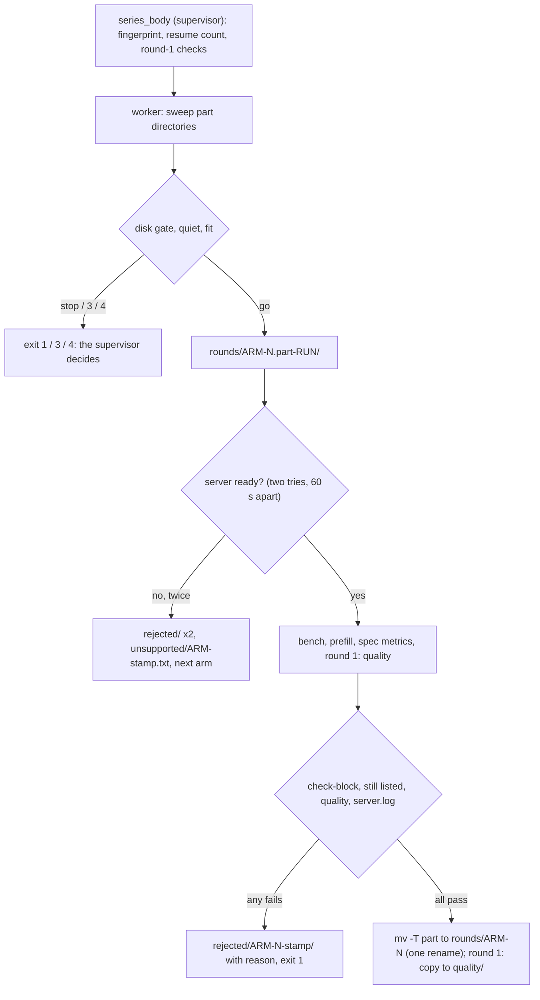
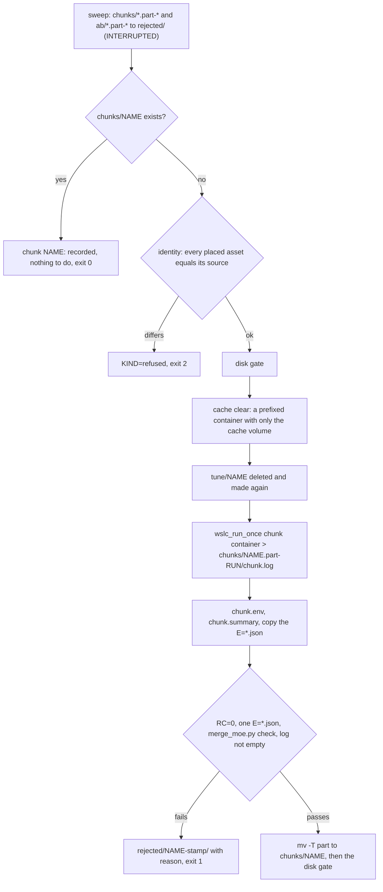
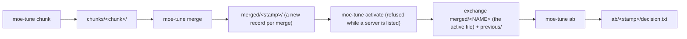
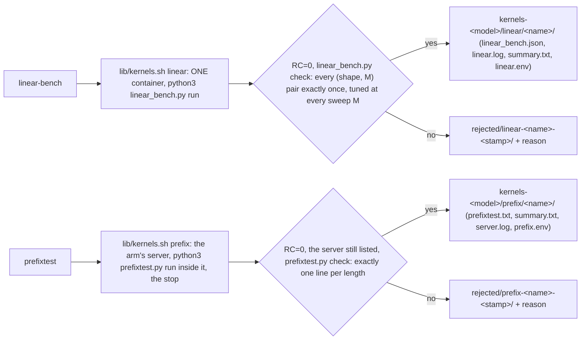
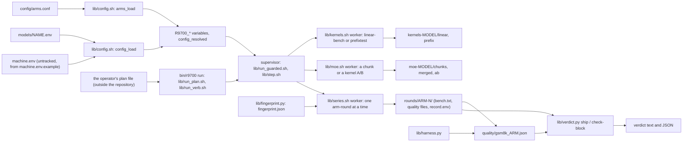

# Architecture — the R9700 vLLM tuning toolkit

Tune and measure vLLM on an AMD Radeon AI PRO R9700 under Windows + WSL2, where containers run with `wslc`. This file describes what EXISTS, by module: the module map is the entry point, the verb table says what each command of `bin/r9700` does and which module serves it, and the sections after them go into each module. Nothing in it describes something that does not run: the config reference is `research/module_config.md`, the tests and what they do not prove are `research/module_tests.md`, the place of every script of the old harness folder is `research/INPUTS_homes.md`, and the records of the runs on the GPU are the `research/ACCEPTANCE_*.md` files.

The toolkit has ten verbs in five groups. A series of server-flag arms with a ship test (`series`, `verdict`). MoE config tuning (`moe-tune`). Two kernel measurements (`linear-bench`, `prefixtest`). A driver that chains the steps of a night under one supervisor (`run`). ComfyUI on the same card, one owner at a time (`comfy`). And the machine verbs (`init`, `step`, `commands`). Every verb that can change the machine runs under the same lifecycle: one lock, the restore of the operator's server first when a marker is left, ONE stop of the operator's server for the run, the guards (RAM, quiet PC, disk, deadline), ONE restore at the end.

## Modules

| Module | Files | Purpose |
|---|---|---|
| Config | `lib/config.sh`, `machine.env.example`, `models/*.env`, `config/arms.conf` | one untracked `machine.env`, one `models/<name>.env` per model, one arm table; a bash loader validates every field before anything runs and never executes the files. Field list: `research/module_config.md` |
| Verdict | `lib/verdict.py` | the ship test over bench lines: complete arm-round blocks only, the base's spread over all its values, exact decimals, GSM8K within 2 x the larger stderr; `check-block` validates one arm-round record |
| Quality harness | `lib/harness.py` | 20 greedy prompts with logprobs, GSM8K scoring, and the two comparisons, against a running vLLM server; results are written atomically |
| Adapter | `lib/adapter.sh`, `lib/serve.sh`, `lib/bench.sh`, `lib/run_guarded.sh` (`t_scale` only so far) | the seam: every call to `wslc` and to Windows PowerShell is a function of `lib/adapter.sh`, under a ceiling that kills the child; `serve_start` and `bench_run` build the measured commands on it. Added by E1.S2 part (a) |
| Ownership and recovery | `bin/r9700` (`commands`, `init`, `verdict` as a restore-first shell), `lib/run_guarded.sh` (lock, session stop, worker start), `lib/worker_gate.sh`, `lib/restore.sh` | one run at a time on the GPU; the operator's server is restored once, ready, even after a hard kill. Added by E1.S2 part (b) |
| Supervisor and guards | `bin/r9700` (`step`), `lib/run_guarded.sh` (`supervise`, `cleanup_once`, outcome file, deadline, run folder), `lib/step.sh` (`step_run`), `lib/guard_quiet.sh`, `lib/guard_ram.sh`, `lib/guard_deadline.sh`, `lib/guard_common.sh`, `lib/disk_gate.sh`, `lib/wait_ready.sh` | one guarded step: wait until the PC is quiet, check the disk log, stop the operator's server (marker first), run the worker in its own session behind the gate, watch it (RAM, deadline), read its typed outcome, retry, and restore once at the end. Added by E1.S2 part (c) |
| Series and verdict | `bin/r9700` (`series`, `verdict`), `lib/series.sh`, `lib/fingerprint.py`, `lib/bench.sh` (`prefill_run`), `lib/serve.sh` (`container_name`, `serve_start --print`), `lib/adapter.sh` (`wslc_run_once`, `wslc_argv_text`) | `series <model> <arm>...` runs arm-rounds in alternating order as ONE step of the supervisor and records each arm-round only when it is complete, by one rename; the same command again resumes, and a resume whose effective experiment differs is refused naming what differs; `verdict <outdir>` prints the ship test over the final records. Added by E1.S3 |
| MoE pure parts (E2.S1) | `lib/merge_moe.py`, `lib/moe_kernel_ab.py`, `config/coarse_candidates.json`, `vendor/` | no container, no GPU. `merge_moe.py check` is the one definition of a valid chunk file; `merge` joins chunk dirs (and a base file) into a NEW file under `--out` and never replaces one. `moe_kernel_ab.py decide` turns the six logs of a kernel A/B into a table and one decision line. `vendor/benchmark_moe.py` is upstream vLLM plus three marked hooks, proven by its diff |
| MoE tuning (E2.S2) | `lib/moe.sh` (the chunk unit, the A/B unit, the cache clear), `lib/run_guarded.sh` (`cleanup_hook_set`, `_rg_cleanup_hook_run`), `config/coarse_candidates.json`, `vendor/benchmark_moe.py` | the two units of `tune_chunk.sh` and `moe_kernel_ab.sh` as WORKERS of one `step_run` each (`bash lib/moe.sh chunk …` / `ab …`); they take no lock, set no trap and never stop the operator's server. A record is made only when complete and valid. The Triton caches are cleared before every unit and in the exit path of the invocation by ONE hook of `cleanup_once`. The verb is E2.S3 (the next row) |
| MoE verb (E2.S3) | `bin/r9700` (`moe-tune`), `lib/moe_verb.sh` (`moe_place`, `moe_merge_verb`, `moe_activate_verb`, `moe_dry_run`), `lib/moe.sh` (the units it starts) | `moe-tune chunk\|merge\|activate\|ab <model> [options]`: the argument grammar is checked before the lock; `chunk` and `ab` are `supervise` around ONE `step_run`; `merge` is a reading verb (the lock only to restore first) that writes a new record `merged/<stamp>/` and replaces nothing; `activate` is `supervise` without a step (no admission) around an atomic swap of the exchange copy, refused while a server is listed. `vendor/benchmark_moe.py` and `config/coarse_candidates.json` are placed in `$WORK_DIR/r9700/` with their hashes checked before anything is stopped. Section *MoE verb* below |
| Kernels (E3.S1) | `bin/r9700` (`linear-bench`, `prefixtest`), `lib/kernels.sh` (the two units and their records), `lib/kernels_verb.sh` (the grammar, the bodies, the dry runs), `lib/linear_bench.py`, `lib/prefixtest.py`, `lib/moe.sh` and `lib/moe_verb.sh` (the placement, the identity check and the cache clear it imports), `lib/series.sh` (the arm's serve options it reuses), `models/*.env` (`LINEAR_SHAPES`, `LINEAR_GROUP_SIZE`) | `linear-bench` times the model's hybrid W4A16 linear shapes in one foreground container; `prefixtest` starts one measured server for one arm and sends the twelve prefix-cache requests; each records only a validated result, under one supervisor |
| Run driver (E3.S2) | `bin/r9700` (`run`), `lib/run_plan.sh` (the plan grammar), `lib/run_verb.sh` (the table of steps, the validation, `--check`, the chain), `lib/run_guarded.sh` (`run_record_init`, `run_record_write`), `lib/step.sh` (`step_budget_reset`, the stop charge) | `run <plan> [--check] [--dry-run]`: a plan file of steps (one verb command line each) under ONE supervisor: one lock, restore first, the operator's server stopped at the first admission and restored once at the end; the exit code is the normalized code of the step that stopped the chain; `run.txt` records every step. Below (*The run driver*) |
| ComfyUI (E1.S2) | `bin/r9700` (`comfy`), `lib/comfy.sh` (the modes `start`, `stop`, `status`, the locked entry `comfy_locked`), `lib/run_guarded.sh` (`comfy_owner_check`, `comfy_owners_check`, `_rg_card_free`, `_rg_listing_tries`), `lib/step.sh` (the admission's check), `lib/restore.sh` (`_restore_comfy_free`, the marker key `COMFY_CONTAINER`, `ready_wait`'s probe argument), `lib/adapter.sh` (`wslc_remove`, `wslc_inspect`, `comfy_probe`), `lib/config.sh` (the two name rules of `COMFY_CONTAINER`) | the operator's own ComfyUI container and the operator's vLLM server share the R9700, and one owner holds it at a time. The rule has two halves. Every verb under `supervise` refuses with exit 2 and one line naming `bin/r9700 comfy stop` while `COMFY_CONTAINER` is listed (right after the prepare, before anything is stopped, and again at every admission), and the one place that starts the operator's server, the restore from the recovery marker, never starts it beside ComfyUI (the marker records `COMFY_CONTAINER`; the restore refuses, the marker stays). `comfy start` takes the toolkit's lock and holds it through the readiness wait; `stop` and `status` take none. Section *ComfyUI (E1.S2)* below |
| Tests | `tests/`, `.github/workflows/tests.yml` | one runner for Python and bash tests, an owned run folder, the static checks (`tests/check_static.sh`, which also refuses a document that carries one of three phrases of unfinished work), the document checks (`tests/test_docs.sh`: the old-script home table, the verb tables, the acceptance templates, `POST_DEPLOY.md`). `research/module_tests.md` |

## Verbs

One row per verb of `bin/r9700 commands` (a test derives the rows from that output). "One supervisor" means `supervise <verb> <prepare> <body>` of `lib/run_guarded.sh`: the lock, restore-first, the config, the deadline, the run folder, the body, the one cleanup.

| Verb | Lifecycle | What it does | Where it is described |
|---|---|---|---|
| `bin/r9700 commands` | none | prints the verbs, derived from the `verb_*` functions of `bin/r9700` | Ownership and recovery |
| `bin/r9700 init` | restore-first, then the checks | loads the config, checks the folders, `wslc`, the RAM and disk telemetry, and stops every leftover test container; exit 10 when a check failed | Ownership and recovery |
| `bin/r9700 step` | one supervisor, ONE `step_run` | runs one command as a guarded step (the engine under every other verb; used by the tests and by hand) | *The step* |
| `bin/r9700 series` | one supervisor, ONE `step_run` for the whole series | arm-rounds of server arms in alternating order, each recorded only when complete, resumable, refused when the identity changed | *Series (E1.S3)* |
| `bin/r9700 verdict` | restore-first only (the lock only when a marker exists) | the ship test over the final arm-round records; no GPU | *The verdict* |
| `bin/r9700 moe-tune` | `chunk` and `ab`: one supervisor, ONE `step_run`; `merge`: reading verb; `activate`: one supervisor without a step | MoE config tuning in four modes with one merge policy | *MoE verb (E2.S3)* |
| `bin/r9700 linear-bench` | one supervisor, ONE `step_run` | times the model's hybrid W4A16 linear shapes in one container | *Kernels and the prefix check (E3.S1)* |
| `bin/r9700 prefixtest` | one supervisor, ONE `step_run` | starts one measured server for one arm and sends twelve prefix-cache requests | *Kernels and the prefix check (E3.S1)* |
| `bin/r9700 run` | one supervisor, one `step_run` per plan line | a plan file of steps (one verb command line each) as one night; `--check` and `--dry-run` | *The run driver (E3.S2)* |
| `bin/r9700 comfy` | `start`: the lock, held through the readiness wait; `stop`, `status`: none | `start [--stop-vllm] [-- <main.py args>]` brings the operator's ComfyUI up (volumes made, a stopped container of the name removed, readiness waited for); `stop` stops it; `status` prints what can be known | *ComfyUI (E1.S2)* |

**Config.** `config_load <machine.env> <model.env>` parses both files line by line, applies the defaults of the field table,
checks every field and the three cross-field rules, and exports `R9700_<KEY>`. It prints every error in one pass
(`config: <file>:<line>: <KEY>: <problem>; legal: <legal>`) and returns 2. `config_keys` prints the field table; the
documentation and the example file are tested against it. The arm table gives, per arm, the serve arguments, the
environment and the extra mounts (`arm_args`, `arm_env`, `arm_mounts`, `arms_check`).

**Adapter.** `lib/adapter.sh` is the only file that expands `$R9700_WSLC`, `$R9700_POWERSHELL` and `$R9700_RESTORE_SHELL`
(`bash tests/check_static.sh --seam` checks it). Every function runs one argv under `timeout --kill-after=5 <ceiling>` with standard
input from `/dev/null`, takes its numbers from `t_scale`, removes CRs, and returns the child's code, 124 at the ceiling, 2 for a bad
argument and 10 when it cannot call (`adapter: …`). A bare executable name is resolved on `PATH` at each call, an absolute path is used
as given. `wslc_stop` prints what wslc printed (stdout and stderr merged, CRs removed, the last 20 lines) and returns wslc's code; it is not a pipeline, so the caller's `TERM` trap and the interrupt chain still reach the call (the output goes through a process substitution that is waited for). A caller that does not want the text redirects it; the step logs it on a failure. `restore_probe` runs one Python program in the server's container: `GET /v1/models` (5 s), then a one-token
`POST /v1/completions` (60 s). `serve_start` builds the argv of the old `serve.sh` from the config and calls `wait_ready`; `bench_run`
runs the six measured `vllm bench serve` runs and prints the tagged metric lines.

**Lock.** `lock_take <verb>` is `flock -n` on `<state dir>/lock`, descriptor 9, opened for append so a refused taker can read the holder line `<pid> <verb> <UTC time>` the winner wrote; the refusal is `r9700: another run holds <path>: pid <pid>, <verb>, since <time>`, exit 4. The state directory is `R9700_STATE_DIR`, else `${XDG_STATE_HOME:-$HOME/.local/state}/r9700`, made private (mode 700); it is not a config field, because the lock and the marker must work when the config is broken. The kernel frees the lock at a `SIGKILL`; every child the supervisor starts has descriptor 9 closed (`worker_start`, every adapter call), or a surviving child would keep it.

**Recovery marker.** `<state dir>/recovery.env`, a `KEY=VALUE` file in the config grammar, written with `.part` and `mv`. First write, before the operator's server is stopped (`marker_write_base`): the marker version, the run id, the time, the server's name and whether it was running, the executables, the start script and arguments, the container prefix, the readiness timeout, `COMFY_CONTAINER` (optional: the name of the operator's ComfyUI, so that the restore can refuse to start the server beside it without a loaded config; a marker written before this key existed has none and is restored as it always was), and `RUN_DIR` (the run's folder, so a restore after a hard kill saves its log tails beside the run's evidence). Second write, once the worker runs (`marker_add_worker`): `WORKER_PGID`, `WORKER_START_TICKS`, `BOOT_ID`, all three together. The worker starts as `setsid lib/worker_gate.sh <gate> <cmd...>` and waits at the gate (30 s, then exit 5, a failed try for the supervisor; 4 is the series worker's "nothing more fits before the deadline", A21); the gate file is created only after the second write is durable, so a worker never works before a restore could find it. The marker is removed only after the restore is ready, or, for a server that was not running, after every prefixed container is stopped.

**Restore.** `restore_from_marker <marker> <run dir>` needs no config: it stops the worker's whole SESSION when the process is provably the recorded one (same boot id; a leader with the recorded start ticks, or no leader at all, never a live leader with other ticks), saves a 200-line tail of every prefixed container and stops it (the container list and every stop are tried up to 3 times, a scaled 10 s apart: a transient fault of `wslc` must not leave the server down; only the third failure is the contract line `r9700: restore: <name> not ready after <n> s (<reason>)`, A22), then — when the server was running before — starts it unless it is listed and waits until `/v1/models` answers and a one-token completion succeeds (`ready_wait`, every 10 s up to `READY_TIMEOUT_S`, three misses of the container listing end it at once). When the marker names a `COMFY_CONTAINER` and that container is in the listing the preparation just read, the restore does NOT start the server: it prints `r9700: restore: <name> not started: the operator's ComfyUI (<comfy>) is listed; run bin/r9700 comfy stop, then any verb restores <name> (the marker stays)`, returns 5 and leaves the marker; the toolkit's own prefixed containers were still stopped, and the next verb after `comfy stop` restores. A restore that is not ready is exit 5 with the one line `r9700: restore: <name> not ready after <n> s (<last probe result>)`, the marker kept and the server left as it is. Every adapter call of the supervisor runs under `timeout` started in the background; after a ceiling its whole process group gets `KILL` (amendment A12).

**The step (E1.S2 part (c)).** `bin/r9700 step [--show-deadline] [--model <file or name>] <label> -- <command...>` is `supervise step prepare_run step_run <label> -- <command...>`. The label is checked against `^[a-z0-9][a-z0-9-]{0,39}$` with the other arguments, before the lock. `supervise <verb> <prepare> <body> [args]` takes the lock, restores from a marker (restore-first), calls `<prepare>` (the config; refused: exit 2), computes the deadline (`T_END = min(next DEADLINE, now + MAX_RUN_MINUTES·60)`, `T_STOP = T_END − CLEANUP_BUDGET_S`, whole seconds rounded down, refused when `T_STOP` is under 60 s away), makes the run folder, installs the `INT`, `TERM` and `HUP` traps, runs the body and ends with the ONE `cleanup_once`. `step_run` runs one step and neither restores nor releases the lock, so a body of several `step_run` calls restores once at the end. `--show-deadline` prints `T_END`, `T_STOP` and `START=ok|refused (<why>)` and takes no lock.

`step_run` is a loop. (1) A quiet wait of at most 900 s and at most the time to `T_STOP` (`quiet_wait`: `R9700_QUIET_CHECKS` quiet checks in a row, 300 s apart; an unreadable load, or a missing `pgrep` while a busy pattern is set, is "not quiet"; every check line in the supervisor log ends with `quiet-checks=<k>/<n>` and, when another check will follow, `next check in <s> s`, in production seconds). A wait that ends not quiet restores the server first when we stopped it (decision 15) and waits again. (2) The disk gate: a baseline at the first admission of the invocation, a check at every later one; a stop is exit 9. (3) Admission: at most `MAX_SERVER_STOPS` per invocation (exit 8 beyond), the recovery marker written BEFORE the stop (copied to `steps/<n>.marker` at once, as evidence if the supervisor dies before the worker starts), the stop of the operator's server when it is listed (`_step_stop_prod`: it runs through `_rg_run`, and a non-zero code is not yet a failure: the code and the last 20 lines of wslc's text are logged as `stop output: <line>`, the container list is read again, and a server that is no longer listed is counted as stopped, logged as `stop returned <rc> but the server is gone: counted as stopped`; one that is still listed, or a second list that cannot be read, is the failed try `admit stopping <server> failed (code <rc>)`. Measured 2026-11-03, first GPU acceptance runs: `wslc stop vllm` returned 1 in 2 of 6 admissions and the server WAS stopped each time, so each admission paid a failed try for a stop that had worked; the cause of the code 1 is not known), the worker started as `setsid lib/worker_gate.sh steps/<n>.gate <command...>` (the supervisor checks that it is its own session leader), the worker keys added to the marker, the evidence copy `steps/<n>.marker` replaced by a copy WITH the worker keys that keeps the time of the first write (before the stop), the RAM guard and the deadline watcher started, the gate file made. `MAX_SERVER_STOPS` is a RUN-WIDE cap on ACTUAL stops of the operator's server (E3.S2 decision 4): `_RG_STOPS` is charged right before `wslc_stop` of the server and only when the server is listed, an admission that finds it already down charges nothing, and an admission that would stop it past the cap is refused (exit 8) before the marker, the stop and any worker; nothing resets the count inside an invocation (`step_budget_reset` resets only the failed tries of the next step). A failed list is a failed try, not a stop. (4) wait for the worker (a loop with its own ceiling: the worker's session is stopped a minute after `T_STOP` if the watcher is gone); the guards are stopped, as whole process trees, and the descendants that lead a process group of their own get the group `KILL`; after a guard or the deadline stopped the step, every prefixed container is stopped AGAIN (the guard may have been killed in the middle of its second container, and a retry must not start next to a live one); whatever is left of the worker's SESSION is stopped; the typed outcome `steps/<n>.outcome` (`KIND` one of `worker`, `ram_guard`, `disk_gate`, `deadline`, `interrupted`, `refused`; `RC`, `DETAIL`, `ENDED_AT`) is created exclusively, so the first writer — the RAM guard, the deadline watcher, the worker itself for the disk gate, or the supervisor after `wait` — wins. (5) The outcome decides: `worker 0` done; `worker 3` waits (not a failed try) with the server kept down for one quiet wait; `worker 4` and `deadline` exit 6; `refused` (the typed outcome a worker writes when it refuses to go on, E1.S3) exit 2 without a retry; `disk_gate` exit 9; anything else is a failed try, and `MAX_FAILED_TRIES` of them are exit 7.

A guard is a background fork of the supervisor with descriptor 9 closed. It writes the outcome FIRST, then stops every prefixed container (log tail saved before the stop) and then the worker's whole session by session id (`TERM`, the grace, `KILL`): GNU `timeout` gives every adapter call a process group of its own inside the worker's session, so a group kill would miss a call in flight (amendment A8). A guard ends by itself when the worker's leader (same start ticks) is gone, and runs without `R9700_T_STOP`: its work is cleanup-phase work. The RAM guard reads every 15 s; below `RAM_MIN_MB` is a stop, exactly at it is fine; a read that is not an integer is a miss, and three in a row are a stop (`telemetry unreadable 3 times`). The supervisor's step-phase adapter calls and the worker's run with `R9700_T_STOP` set (amendment A9); the cleanup phase runs without it (decision 8).

`cleanup_once <kind>` runs once per invocation (a flag; the second call returns the first one's result). It ignores `INT`, `TERM` and `HUP` from its first line, BEFORE it sets the flag, then: stops the guards, stops the worker's session, stops every prefixed container (when a worker ever started), restores the operator's server when a marker stands (not again when a restore of this invocation already failed: the marker stays), writes `<run dir>/status` (`done`, `failed`, `deadline`, `interrupted`, `restore-failed`, `not-quiet`, `disk-gate`; `running` while the run lives) and releases the lock. The handler of `INT`, `TERM` and `HUP` writes `KIND=interrupted` to the running step's outcome, runs `cleanup_once interrupted`, prints `r9700: interrupted, restored` and exits 130, 143 or 129; an `EXIT` trap runs the same cleanup for an `exit` in a body. Bash holds a trapped signal until a foreground command ends, so the supervisor's own waits are background jobs (`_rg_sleep`, `_rg_run`): a `TERM` ends a sleep or an adapter call of the admission at once (the call's whole process group is killed). The restore inside a run (decision 15) and the readiness sleep are foreground: a signal waits for the current call, at most its ceiling.

**MoE pure parts (E2.S1).** Three files with no side effects beyond their own output, so every rule of tuning that can be checked without a GPU is checked in CI.

- `lib/merge_moe.py check --keys "<bs…>" <file>` parses one chunk file (`{"triton_version": v, "<batch size>": {config}}`): JSON, a `triton_version`, keys that are positive integers
  written once, every config holding the six fields (`FIELDS`; more are allowed, `waves_per_eu` and `SPLIT_K` are), and exactly the promised keys. Exit 0, or 1 with the first problem on stdout.
- `lib/merge_moe.py merge --out <dir> [--base <file>] [--expect "<bs…>"] <chunk dir>…` reads every chunk dir (exactly one `E=*.json`, read back and never typed, and an optional `chunk.env` with
  `KEYS=` and the identity words `IMAGE`, `MODEL_DIR`, `DTYPE`, `LAYER`), reports every problem in one pass (`merge: …`, exit 2), and writes `<out>/<NAME>` in the sources' format. The expected key
  set is the base's keys plus each chunk's `KEYS=` promise (what the chunk holds when it has no `chunk.env`; a `chunk.env` without `KEYS=` is refused); `--expect` replaces it. An identity word set in some chunks and not in others is refused. The write goes to `<NAME>.part-<pid>-<start ticks>` and is
  moved with `os.link`, which fails when the name exists: **a merge never replaces a file** (append-only; which file a server reads is a separate step). A part whose owner is gone is removed
  before the next write; a part whose owner lives is a refusal. Where hard links fail, the write takes a `<NAME>.claim` (`O_EXCL`, owner inside, swept when dead) around check and replace.
- `lib/moe_kernel_ab.py decide <dir> --keys … --rule each|median --rule-keys …` takes the median of `reps` values per batch size and arm (a rep is a log: every log must be there and hold each batch size once) (exact decimals, strict comparison with the threshold),
  prints the table, one config line per arm and batch size, and `KERNEL: faster|not faster (<why>)`. Exit 0 faster, 1 not faster, 2 not decidable (a missing rep is `incomplete:`, nothing on stdout).
- `vendor/benchmark_moe.py`: see `vendor/README.md` (upstream commit and hash, the three hooks, the diff). `config/coarse_candidates.json`: 82 configs, the 81-config product plus the batch-size-1 winner.

```mermaid
sequenceDiagram
  participant S as supervise (bin/r9700 step)
  participant G as guards (RAM, deadline)
  participant W as worker (own session)
  participant P as operator's server
  S->>S: lock, restore from a marker, config, deadline, run folder
  loop step_run until done or a final code
    S->>S: quiet wait (restore the server first if it is down and the PC is busy)
    S->>S: disk gate (baseline or check)
    S->>S: marker written, copied; stop the server; admitted
    S->>W: setsid worker_gate.sh steps/n.gate cmd, marker gets the worker keys
    S->>G: guards started, then the gate file is made
    W-->>S: exit code (or a guard wrote the outcome and stopped the session)
    S->>S: guards stopped, session stopped, outcome settled
  end
  S->>S: cleanup_once: session, containers (tails first), restore, marker removed, status, lock
  S->>P: start script, readiness probe (once)
```

**Exit codes of `bin/r9700`** (E1.S2 parts (b) and (c)):

| Exit | Meaning | Line on stderr |
|---|---|---|
| 0 | done | — |
| 1 | `verdict`: at least one arm is INCOMPLETE (`verdict.py`'s own code; an input error, or a base with no final record, is 2); `comfy start`: the operator's server could not be stopped, or a volume, the remove or the run call failed (nothing of ComfyUI is left running; the operator's server was restored when this invocation had stopped it); `comfy stop`: the container did not stop; `comfy status`: a state could not be read | the `verdict <arm>: INCOMPLETE (…)` line on stdout; `r9700: comfy: <mode>: …` |
| 2 | config or arguments refused; `comfy`: a refused argument or mode, a machine config refused (the two name rules of `COMFY_CONTAINER` among them), a start beside the operator's listed server without `--stop-vllm`, a container list that failed three times; every verb under the supervisor: the operator's ComfyUI is listed (the line names `bin/r9700 comfy stop`) | S1's `config: …` lines, `deadline: only <n> s remain before the cleanup budget`, `r9700: <verb>: …`, or `r9700: the operator's ComfyUI (<name>) is listed and holds the card; run bin/r9700 comfy stop first` |
| 4 | another run holds the lock (`comfy start` holds it through its readiness wait) | `r9700: another run holds <path>: pid <pid>, <verb>, since <time>` |
| 5 | the restore did not become ready, or was not started beside the operator's ComfyUI (the marker stays); `comfy start`: ComfyUI did not become ready (its log tail is saved, it is stopped, the operator's server is restored when this invocation stopped it), or the container list could not be read after the launch (nothing stopped; the line names `comfy stop` and `init`; the marker stays when the operator's server is owed) | `r9700: restore: <name> not ready after <n> s (<last probe result>)`, `r9700: restore: <name> not started: the operator's ComfyUI (<comfy>) is listed; …`, or `r9700: comfy: start: …` |
| 6 | the deadline or `MAX_RUN_MINUTES` stopped the step, or the worker said nothing more fits (worker 4) | `r9700: deadline: step stopped at <time>, <n> units done` (n: steps of this invocation that ended done) |
| 2 (series) | the series worker refused to go on (outcome `KIND=refused`): the identity of the series changed between two arm-rounds or start tries | `r9700: the worker refused to go on: fingerprint differs: <path>: <old> -> <new>` |
| 7 | the step failed `MAX_FAILED_TRIES` times | `r9700: step failed <n> times, last: <KIND> <DETAIL>` |
| 8 | not quiet before the deadline, or the server-stop budget is used (E3.S2: the budget counts ACTUAL stops of the operator's server), or a worker exited 3 more often than the repeat bound | `r9700: not quiet before the deadline` / `r9700: stopped the operator's server <n> times, limit MAX_SERVER_STOPS=<n>` / `r9700: <step> waited <n> times (worker exit 3), limit <m>` |
| 9 | the disk gate stopped the run | `r9700: disk gate: <its line>` |
| 10 | `init` found a problem | `init: <check>: <problem>` |
| 11 | the recovery marker cannot be read | `marker: <file>:<line>: …`, then `r9700: recovery marker <file> is unreadable: check the operator's server by hand, then remove <file>` |
| 129 / 130 / 143 | interrupted by `HUP` / `INT` / `TERM`; cleanup and restore ran | `r9700: interrupted, restored` |

**Growth surfaces of part (c).** `<RESULTS_DIR>/runs/<UTC stamp>-<pid>/` holds one invocation: `status`, `supervisor.log`, `disk_gate.state`, `steps/<n>.{gate,worker.log,outcome,marker,ram_guard.log,deadline.log}` and `guard/<stamp>-<container>.tail.log`. It is collected data: append-only, never removed or trimmed by the toolkit; its owner is the operator, who deletes a folder by hand when the run is no longer evidence. The per-call output files `.call.<pid>.<n>` live in it for the length of one call and are removed after it.

**Growth surfaces of part (b).** `<state dir>/restore-<run id>/` holds the log tails of a restore after a hard kill when the marker has no run folder of its own. Its owner is `init`: it keeps the newest 10 (by modification time) and removes older ones by exact name (`restore-` and a valid run id; never by prefix alone, never a link, never a file). The lock file and the marker are single files, rewritten, not grown. Readiness is bounded by `READY_TIMEOUT_S` and cut by its own stop time (amendment A13; both readiness loops, `ready_wait` and `wait_ready`, sleep through `sleep_in_window`, so the last sleep is cut to what the window has left and the wait ends when the window does, not a whole interval later), so the cleanup budget `READY_TIMEOUT_S + 300` holds it.

**Series (E1.S3).** `bin/r9700 series <model> <arm>... [--out <name>] [--rounds <1..20>] [--dry-run]` is `supervise series series_prepare series_body`. The arguments are checked before the lock; `series_prepare` loads the config, the arm table and the arms (an arm that is not in `config/arms.conf`, a mount that is missing, or a name too long for a container label are exit 2). `series_body` runs in the supervisor, BEFORE admission: (1) the fingerprint (a fingerprint is never built over records: `rounds/` or `rejected/` without a `fingerprint.json` is exit 2, naming the remedy, a new `--out` name); (2) `--dry-run` runs the same checks and prints the resolved commands of the first arm-round and ends, writing NOTHING in the outdir (no `fingerprint.json`, no merge of a new arm or more rounds, not even the folder: a dry run never changes a series); (3) the quality copies are synchronised; (4) the arm-rounds without a final record or an `unsupported/` mark are counted, and when none is left `series: <done> of <all> arm-rounds recorded, nothing to do` ends the invocation without admitting; (5) when round 1 has an arm-round to run, `harness.py` is copied to `<WORK_DIR>/r9700/` (hash checked) and the GSM8K data is checked; (6) `step_run series -- bash lib/series.sh <outdir> <rounds> <arm>...`: the whole series is ONE step, so the operator's server is stopped once and restored once. A refused resume, an empty listing and a missing GSM8K file are therefore exit 2 with nothing stopped. The throwaway container of the fingerprint runs through `_rg_run` like every other supervisor call, so a `TERM` during it ends it at once (143).

*The fingerprint* is `<outdir>/fingerprint.json`, `{"version": 1, "sha256", "components"}`; the hash is over the canonical form of `components` (`sort_keys`, compact, ASCII). Components: the model's fields (directory, served name, context, sequences, GPU fraction, extra arguments, tuned folder, mounts), the SHA-256 of the model's file listing (names and sizes from a throwaway container, `wslc run --rm`: no weights are read, so a same-size edit of a weight file is not seen) and of the generation config (every file under `/genconfig`, nested and hidden included), the image tag, the hash of every patch file of the model and of the arms, every arm's arguments, environment and mounts, the base arm, the workload constants, the round count, the hash of every module a unit runs (`tools`, A24: the shell libraries the worker sources, `lib/series.sh` itself and the Python programs it calls, from the two lists `_SERIES_UNIT_SH` and `_SERIES_UNIT_PY` in `lib/series.sh`, which the worker's source loop uses too), and the container prefix and GSM8K path. `lib/series.sh` writes one input file per group; `lib/fingerprint.py` builds the JSON. A fingerprint document is read only when its `version` is supported and its `sha256` equals the digest recomputed from its `components` (compare, show, `--probe-from`, so the series start and the verdict too): an edited or damaged file is exit 2 naming the file, never a silent identity. On an existing outdir `compare --merge` prints one line per differing leaf, `fingerprint differs: <dotted path>: <old> -> <new>`, and the series refuses (exit 2, the lines on stderr). A new arm and a larger round count are extensions (`fingerprint: arm <name> added`, `fingerprint: rounds extended <old> -> <new>`; the stored file is rewritten atomically): an arm-round record depends on its own arm, round, model, image, patches and workload, not on which other arms exist or how many rounds were asked for. An arm left out of a later invocation is not a difference; another base and fewer rounds are. The fingerprint is computed ONCE by the supervisor, but one step can restart the worker many times, hours apart, while the worker re-reads `arms.conf` and the containers mount the patch files live; so the worker re-checks the cheap components (config, arms, patches, tools; `fingerprint.py build --probe-from <stored>` takes the model listing and the generation config from the stored file, the throwaway container is not run again) at the start of EVERY arm-round, after the gate and before its server starts. The identity is checked at each unit start and before each start try; an edit during a running unit is seen by the next unit; final records are not re-judged. A difference prints the `fingerprint differs` lines, writes `KIND=refused RC=2` to the outcome, and the supervisor reads that typed outcome as a refusal (`r9700: the worker refused to go on: <lines>`, exit 2, no retry, one restore); a plain exit 2 of a step command without that outcome stays a failed try (S2 decision 6), the worker gate's own bad-arguments exit 2 included; the arm-round has no record and no `rejected/` attempt.

*The worker* (`lib/series.sh` run as the step's command) sweeps first: a `rounds/*.part-*` directory an earlier worker left is moved to `rejected/` with an `INTERRUPTED` reason, never trusted. Then, per `round`, per `arm` (so the arms alternate inside a round): skip a final record or an unsupported arm; the disk gate (a stop writes `KIND=disk_gate`, exit 1); the quiet check (not quiet: `NOT QUIET: <arm> round <n>`, exit 3, the supervisor waits and admits again); the fit check (`now + R9700_ARM_SECONDS (default 1500) > T_STOP`: exit 4, which the supervisor reads as the deadline, exit 6, not as a failed try); the identity re-check (above; exit 2); `rounds/<arm>-<round>.part-<run id>/`; the server start (`serve_start`, the tuned MoE folder first and the arm's own environment after it, so the arm's wins); a start that fails is stopped, kept in `rejected/` with its log, and retried once 60 s later under the container name `<label>-r2`; a second failure writes `unsupported/<arm>-<UTC stamp>.txt` (the last three `Error` lines and the two rejected paths) and the series goes on. Then `server_config.txt`, `bench_run` and `prefill_run` into `bench.txt` (36 lines for two prefill lengths), `spec_metrics.txt`, and in round 1 the two quality files (`collect`, `gsm8k` through `/work/r9700/harness.py`, moved in from `<WORK_DIR>/r9700/<series>/`). The validation: (a) `verdict.py check-block` accepts `bench.txt` (the ONE definition of complete), (b) the container is still listed, (c) in round 1 `fingerprint.py check-quality` accepts the two files, (d) `server.log` is not empty. The record becomes final by `mv -T <part> rounds/<arm>-<round>`, one `rename(2)`; a failed validation moves the directory to `rejected/<arm>-<round>-<stamp>/` with a `reason` (`LOST: server alive 0` or `REJECTED: server alive 1`, then one `check-block:`, `quality:` or `server.log:` line per problem) and the worker exits 1, a failed try for the supervisor. After the rename the round-1 `gsm8k_<arm>.json` is copied to `quality/` (a copy, not a link) and `series_quality_sync` restores a missing copy at the next start. `series.sh` sets no trap and never stops the operator's server.



*The verdict.* `bin/r9700 verdict <outdir> [--base <arm>] [--no-quality] [--json <file>]` (after the restore-first half of S2) prints `series <outdir>: base <arm>, <n> rounds, fingerprint <12 hex>`, the one-round note (`note: 1 round, 3 values per concurrency; the recorded ship test used 3 rounds (9)`), one `verdict <arm>: UNSUPPORTED (did not start twice, <stamp>)` line per unsupported arm, an `invoking:` line with the `verdict.py ship` argv, and then `verdict.py`'s output and exit code. It passes only the final `rounds/<arm>-<round>/bench.txt` files, so a part directory or a rejected attempt never reaches it, and never the base as an arm. An unsupported base is exit 2; a base with no final record is exit 2 (`base arm "<arm>" has no complete arm-round in the inputs`); an arm with a missing round is INCOMPLETE, never PASS or FAIL.

**Growth surfaces of E1.S3.** `<RESULTS_DIR>/<name>/` (the series outdir) holds `fingerprint.json` (≈10 KB), `rounds/<arm>-<round>/` (`bench.txt` ≈3 KB, `spec_metrics.txt` ≈2 KB, `server.log` ≈300 KB, `server_config.txt` ≈1 KB, `record.env`, and in round 1 `prompts_<arm>.json` ≈250 KB and `gsm8k_<arm>.json` ≈100 KB), `quality/` (the GSM8K copies, ≈100 KB per arm), `rejected/` (a failed or interrupted attempt, ≈300 KB each: at most `MAX_FAILED_TRIES` per invocation, and two per unsupported arm) and `unsupported/` (a few lines each). A 3-arm, 3-round series is about 4.2 MB plus the supervisor's run folders. It is collected data: append-only, never removed or trimmed by the toolkit; its owner is the operator. The throwaway fingerprint input folder `.fingerprint-inputs.part-<run id>/` lives in the outdir for the length of one invocation and is removed by it, or by the next invocation after a kill.

**Order of every invocation** that can change the machine: arguments, lock, restore from a marker, config, deadline, work. `verdict` takes the lock only when a marker exists and releases it after the restore.

**Verdict.** `ship` reads bench lines in the grammar `<arm>-<round> <group> r=<n> <metric>: <value>`, splits them into
blocks per `<arm>-<round>`, keeps the last complete block of each, and names every other block. The base's spread at c=1 and
c=4 is max - min over its 3 rounds x 3 seeds; an arm passes on speed when its median is higher than the base's by more than
that spread at one concurrency and lower by more than it at none, and on quality when its GSM8K accuracy is within twice the
larger stderr. Exit 0 every arm decided, 1 an arm is incomplete, 2 an input error. The GSM8K files must be comparable: the same n for the arm and the base, at least 200 (`--min-gsm8k-n N` lowers the minimum and the output says so), and a stderr that matches sqrt(p(1-p)/n) of the file's own accuracy and n (within 0.00001), because the 2 x stderr limit is built from it; a forged stderr is refused with exit 2, a different or too small n leaves the arm incomplete.

**Quality harness.** `collect` runs the 20 prompts one at a time at temperature 0; `compare` finds where two runs diverge and
whether the divergences are near-ties; `gsm8k` scores a test file through the chat endpoint; `gsm8k-compare` applies the
2 x stderr limit. A result file is written to `<path>.part` and moved over the target.

## MoE tuning (E2.S2)

**The units.** `bash lib/moe.sh chunk <outdir> <model> <chunk> <layer> <search> <keys…>` runs ONE tuning chunk (layer `experts` or `draft`, search `full` or `coarse`), `bash lib/moe.sh ab <outdir> <model> <layer> <rule> "<rule keys>" <reps> "<keys>"` ONE kernel A/B. Each is the command of one `step_run` (so: one admission, the guards of E1, the typed outcome, the retries). Exit codes: 0 done (recorded, or already recorded: `chunk <name>: recorded, nothing to do`; an already recorded chunk counts only when its `chunk.env` names the activation dtype this run tunes for, `MOE_ACT_DTYPE` for the experts layer: another dtype, or none as in the older records, is a refusal that asks for another `--out`), 1 the unit failed (a rejected record is a failed try), 2 refused. A refusal by the identity check, by `MOE_DTYPE=none` or by an A/B without its merged file writes the outcome `KIND=refused`, so `step` stops at once (exit 2, no retry, one restore); a bad argument is a plain 2 with one `moe:` line. A unit whose container was cut by the stop time writes `KIND=deadline` (the deadline watcher may be first: the first writer wins) and leaves its part for the next start's sweep.

**Identity of a record.** The hashes of the placed assets (and, for an A/B, of the activated file) are taken right after the identity check and are what `chunk.env` and `ab.env` name. They are taken again when the container has ended: a difference (an edit during a long unit) rejects the record with the reason `<asset> changed during the run (<old> -> <new>)`. After the stop time the disk gate is not asked (the adapter refuses every call then): the unit writes `KIND=deadline`. An exchange folder `tune/<chunk>/` that cannot be emptied refuses the unit (`KIND=refused`: a stale file would pass `check`). `supervise` clears the hook registered before it at its start and keeps it only once prepare, the deadline and the run folder have succeeded, so an early return leaves no hook for the next invocation of the process.

**Code gate (E2).** The A/B's `decision.txt` is the one line of decide's stdout that starts with `KERNEL:`, and there must be exactly one: zero or two reject the record (the last line is not assumed). The A/B prints `  ab rep <r>/<n>: <arm>` before each container; a chunk prints `  chunk <name>: running <m> min` every 5 production minutes (a heartbeat fork of the worker, ended when the container call returns; the argv and `chunk.log` are untouched). A failed cache clear BEFORE a unit refuses it (`KIND=refused`: a stale cache is never measured); the exit-path hook stays best-effort. The current hashes of the placed assets are computed in one pass. The batch-size list grammar (1 to 20 distinct whole numbers from 1 to 65536, whitespace-separated, e.g. `8 16 24`) is in ONE Python module, `lib/moekeys.py`, used by `merge_moe.py` and `moe_kernel_ab.py`; `_moe_keys_problem` in `lib/moe.sh` has NO grammar of its own: it calls `python3 lib/moekeys.py check` (one call; the message names the option, the format and the limits), and `tests/test_moekeys.py` feeds the module, the command line and the worker the same edge cases. `merge_moe.py`'s `proc_ticks` returns "not known" for a `/proc` line it cannot read, and a claim file that is empty or unparseable and older than 60 s (`R9700_TEST_CLAIM_STALE_S` scales it) is swept with a `removed stale` line, so a writer killed between the create and the write cannot block merges for ever.

**Final round (E2).** The layer of the file an A/B reads is RECORDED, never guessed: `merge` writes `LAYER` into `merge.env` (`--layer`, else the chunks' own `chunk.env`), `activate` takes it from there (or from `--layer`; the two must agree; a record whose layer nobody says is refused with the remedy) and writes `LAYER` and `NAME` (and the record's `ACT_DTYPE` and `BASE_ACT_DTYPE`) into `activate.env`. `ab` reads the layer and the name from `activate.env` and records the two dtype words in `ab.env` as `FILE_ACT_DTYPE` and `FILE_BASE_ACT_DTYPE` (`unknown` for an `activate.env` of an older version, also one finished by the recovery below), with one `note:` when they are not the run's kind; it never refuses for them. Because both words come from `activate.env`, an `ab` in another `--out`, or with the files of two layers in `merged/`, finds the right file; no `activate.env`, no layer, or another layer than the one asked for is `KIND=refused` with what to do (`activate.env` names the layer activated LAST: re-activate the other layer's record to read its file). A container path is translated to a host path in ONE place, `container_host_path` (`lib/serve.sh`; `moe_exchange_dir`, `moe_placed_dir`, the GSM8K file and the quality files use it): a path not under `/work` does not translate, and `merge --base auto` over such a `TUNED_CONFIG_DIR` REFUSES (pass `--base <file>` or `--base none`) instead of meaning "no base". `moe_place` refreshes an optional asset (`harness.py`) that is already placed by an older series, so it never fails the identity check of every unit for ever. A hard kill between the swap and the rename of `activate.env` leaves `activate.env.part-<pid>-<ticks>` of a dead owner whose config part is gone and whose `SHA256` is the active file's: the next `activate` and the start of an A/B finish the rename (`recovered activate.env from …`); any other leftover is swept by `activate` and makes an A/B refuse. The pre-unit clear prints `cache clear: running (ceiling <n> s)` first.

**The exchange folder.** The containers see `/work` only, so a chunk saves into `$WORK_DIR/r9700/moe/<model>/tune/<chunk>/` (container path `/work/r9700/moe/<model>/tune/<chunk>/`). It is scratch: deleted and made again before every run of that chunk (a half-written chunk holds no evidence, and a stale file there would pass `check`). The record is copied out of it. `merged/` in the same folder is what `activate` (E2.S3) fills and what the A/B's tuned arm reads.

**The record life cycle.**



`chunks/<chunk>/` holds the JSON under the name vLLM gave it, `chunk.log`, `chunk.summary` (the grep of `tune_chunk.sh` line 21), `chunk.env` (the keys it promised, the layer, the dtype, the identity hashes of the three placed files — `absent` for one that is not there — the image, the model directory, the run id and the times). The A/B record `ab/<stamp>/` holds `default-<rep>.log` and `tuned-<rep>.log` (one file per container, written once, never appended to: `decide` refuses a repeated key), `ab.env`, `summary.txt` and `decision.txt`. It is made only when every log holds one `Kernel time` line per key AND every tuned log shows `Using configuration from <B folder>/<B file> for MoE layer`: without the second rule a decision could compare the default config with itself. `decide` exiting 0 (faster) or 1 (not faster) are both complete records. The identity check iterates `moe_assets` (benchmark, candidates, harness) on EVERY unit, whatever the mode, and refuses a placed file that differs from its source in the repository.

**The cleanup hook.** `cleanup_hook_set <function>` registers one function (the MoE verb registers `moe_cache_clear` before `supervise`); `cleanup_once` runs it once, after `container_stop_all` and before the restore, and only when a step was admitted. It runs as a background fork of the supervisor under an ENFORCED ceiling (`t_ceiling 60` plus the 5 s grace, in wall time) and a fork still alive then is ended with `_rg_tree_kill`; the log line is `cleanup hook: <name> rc=<n>` or `cleanup hook: <name> timeout after <n> s, killed`. Neither changes the cleanup's result: the restore runs whatever the clear did. A foreground hook would be wrong: the cleanup ignores signals, so a call whose own ceiling does not hold would hang it before the restore. The clear container's own adapter ceiling (90 s) is deliberately LONGER than the supervisor's window, so the supervisor's is the outer, enforced one. **The budget rule** follows: `CLEANUP_BUDGET_S ≥ READY_TIMEOUT_S + 365` (300 for the restore, 65 for the hook), default 1565; `READY_TIMEOUT_S` tops out at 3235.

**Growth surfaces.** `<RESULTS_DIR>/moe-<model>/chunks/` ≈ 35 KB per chunk and `ab/` ≈ 25 KB per A/B, kept forever; `rejected/` ≈ 35 KB per rejected attempt (at most `MAX_FAILED_TRIES` per invocation), kept forever; a cut chunk's `.part-` goes there at the next worker start. The exchange folder `tune/<chunk>/` ≈ 1–3 KB, deleted before every run of that chunk. The Triton caches `triton-moe-tune` and `triton-moe-ab` in the cache volume grow by 0.5–1.3 GB per chunk and are cleared before every unit and by the hook; a hard-killed supervisor runs no hook, so the next unit's start is what clears them.

## MoE verb (E2.S3)

**One verb, four modes, one merge policy.** `bin/r9700 moe-tune <mode> <model> [options]` (the function is `verb_moe_tune`; `commands` prints the name with a hyphen).
The policy: a merge writes a new versioned record and replaces nothing; `activate` is the only step that changes what a server or an A/B reads, it is explicit,
atomic, keeps the previous file and is refused while a container that may read the folder is listed.

| Mode | Lifecycle | What it does |
|---|---|---|
| `chunk` | `supervise moe-tune moe_prepare moe_chunk_body` | `moe_place` (the files, hash-checked), the dry run, the count of a recorded chunk (before admission), `cleanup_hook_set moe_cache_clear`, `step_run moe-chunk -- bash lib/moe.sh chunk …` |
| `ab` | `supervise …` with `moe_ab_body` | the same order; `step_run moe-ab -- bash lib/moe.sh ab …`; prints the new record and its decision |
| `merge` | reading verb: the lock only when a marker exists, to restore first; then the config | `lib/merge_moe.py merge --out <outdir>/merged/<stamp>/ [--base <file>] <outdir>/chunks/<chunk>…`, then `merge.env` (`CHUNKS`, `LAYER`, `ACT_DTYPE` the chunks' common activation dtype or `unknown`, `BASE_ACT_DTYPE` `none` or `unknown`, `BASE`, `BASE_SHA256`, `OUTPUT_SHA256`, `WRITTEN_AT`) and the `note:` lines for what it mixes (a base of unknown dtype; chunks that name none; experts chunks whose dtype differs from the model's `MOE_ACT_DTYPE`): a merge is never refused for them. `--base auto` is the file of the merged name in `TUNED_CONFIG_DIR` when that folder is under `/work` |
| `activate` | `supervise …` with `moe_activate_body`: lock, restore-first, config, the deadline and the run folder (so it is refused when the deadline leaves no room), the swap, the one cleanup; no `step_run`, so no admission, no marker and no cleanup hook | the record must hold one `E=*.json`; the listed containers are read (`wslc_list`) and the operator's server or any prefixed one refuses the swap unless `--force` (logged); stale `.part-<pid>-<ticks>` files of dead owners are swept; the active file is copied to `merged/previous/<UTC stamp>-<NAME>`; `activate.env` is written to a part FIRST; then the record's file is written to a part beside the active one, fsynced and moved with `mv -T` (one `rename(2)`); then `activate.env`'s part is renamed into place. Recoverable: a failed swap removes both parts and changes nothing; a failed rename of `activate.env` puts the previous file back from `merged/previous/` (or removes the new file when none was active) and refuses. `activate.env` holds (`STAMP`, `NAME`, `LAYER`, `ACT_DTYPE`, `BASE_ACT_DTYPE` copied from the record's `merge.env`, `unknown` for a record that has none, `SHA256`, `PREVIOUS`, `ACTIVATED_AT`, `FORCED`) |



The exit codes are the supervisor's table above; `moe-tune` adds none. Exit 2 also covers a bad argument (one `r9700: moe-tune: <mode>: …` line, before the lock),
`MOE_DTYPE=none` for the experts layer, a recorded chunk of another activation dtype, a merge input error (`merge_moe.py`'s code) and an activation that is refused (not a record, or a server is listed); 4 is
another run holding the lock, 5 a restore-first that did not become ready.

**Placed files.** `moe_place` copies the `required` rows of `moe_assets` (`vendor/benchmark_moe.py`, `config/coarse_candidates.json`) to `$WORK_DIR/r9700/` through a `.part`
and a move when the hash differs, then checks the hash again; a failure is exit 2 before any stop. The worker checks them again on every unit (E2.S2 decision 8).

**Dry run.** `--dry-run` (chunk, ab) prints `dry-run: wslc run --rm --name …` lines built by the worker's own `moe_argv` (the folder word of each arm comes from `_moe_ab_arm_envs`, the one function the worker uses too) and the clear's line. It starts no container, stops nothing and writes no record or part. It is NOT lock-free or read-only: like `activate` it runs inside `supervise`, so it takes the lock (exit 4 when held), runs the restore-first when a marker exists, makes `runs/<id>/` (with its `supervisor.log`), is refused by `deadline_compute` when the deadline leaves no room, and places the two vendored files in the work folder (a hash-checked copy).

**Growth surfaces.** `<RESULTS_DIR>/moe-<model>/merged/<stamp>/` ≈ 3 KB per merge, kept forever (a `.part-<pid>-<ticks>` of an interrupted merge stays in its own folder, never
reused). `<WORK_DIR>/r9700/moe/<model>/merged/` holds the active file and `activate.env` (≈ 3 KB) and `previous/<stamp>-<NAME>` ≈ 3 KB per activation, kept forever; a
part file of an activation killed in its window is removed by the next `activate` when its owner is dead. `<WORK_DIR>/r9700/benchmark_moe.py` (41 KB) and `coarse_candidates.json` (11 KB) are
replaced when `vendor/` changes.

## Kernels and the prefix check (E3.S1)

**Two verbs, two units, one lifecycle.** `bin/r9700 linear-bench <model> [--name <name>] [--ms "…"] [--sweep-ms "…"] [--timer graph|eager] [--out <name>] [--dry-run]` and
`bin/r9700 prefixtest <model> [--name <name>] [--arm <arm>] [--lens "…"] [--tail <n>] [--out <name>] [--dry-run]` (`verb_linear_bench`, `verb_prefixtest`). Both are
`supervise <verb> kernels_prepare kernels_<linear|prefix>_body`: the grammar is checked before the lock, then the lock, the restore-first, the config, and ONE `step_run`.
The exit table above is unchanged: the verbs add no code. Exit 2 also covers a model with no `LINEAR_SHAPES` (`linear-bench`), a length that does not fit
`MAX_MODEL_LEN`, an arm that is not in the table and a `--name` that names the record of another experiment.

| Verb | Body order | The worker |
|---|---|---|
| `linear-bench` | `kernels: outdir …`, `moe_place kernels_assets` (hash-checked, before any stop), the dry run, the same-experiment check and the count of a recorded name (both before admission), `cleanup_hook_set moe_cache_clear`, `step_run linear-bench -- bash lib/kernels.sh linear …`, then the record's name and `summary.txt` | the identity check of every placed asset, the disk gate, the cache clear (a failed one refuses the unit), the exchange folder `<WORK_DIR>/r9700/linear/<name>/` made again, ONE foreground container (`wslc_run_once`, ceiling 5400 s cut at `T_STOP`), validation, ONE rename |
| `prefixtest` | the same order without the cache hook | the same checks, `serve_start` of the arm's server with the series' own option builder (`_series_serve_options`), `wslc_exec` of `prefixtest.py run` inside it (ceiling 1800 s), the server's logs saved and the server stopped by name, validation, ONE rename |



**Reuse, not copies.** `moe_place`, `moe_identity_check`, `moe_asset_hashes` and `_moe_assets_unchanged` take the NAME of an assets function (default `moe_assets`, so the MoE
callers and tests are unchanged); `kernels_assets` lists `linear_bench.py` and `prefixtest.py`. `_MOE_WHO` and `_MOE_PLACED_BY` name the caller in a refusal. The cache clear is the ONE
hook: `_MOE_CLEAR_SH` clears `triton-linear` besides the two MoE folders, whichever units an invocation ran.

**Records.** `<RESULTS_DIR>/kernels-<model>/linear/<name>/` and `prefix/<name>/` are final; while built they are `<name>.part-<run id>/`. A record becomes final by ONE rename after the
validation; a failed one moves to `rejected/<kind>-<name>-<stamp>/` with a `reason`; a part a killed worker left moves there as `INTERRUPTED` at the next start of any kernels unit. A server
that does not start or become ready is stopped by name before the worker exits (so the next try does not meet it). `moe_stop_by_name` (`lib/moe.sh`, never fatal, no stop time) is the one stop-by-name of a container a cut call left running: the linear and chunk units call it when a foreground call ended non-zero. `--name` defaults to the UTC stamp (a new record every run); with a name
the record is "recorded, nothing to do" only when its env file names the same experiment (`MODEL`, `IMAGE`, `MODEL_DIR`, the asset hashes and the run parameters): a difference is
exit 2 with one line per key (`<KEY> "<recorded>" -> "<requested>"`) before anything is stopped.

**Growth surfaces.** `kernels-<model>/linear/<name>/` ≈ 35 KB per run and `prefix/<name>/` ≈ 0.3 MB (the server log), kept forever; `rejected/` ≈ 35 KB (linear) or ≈ 0.3 MB (prefix) per
rejected attempt, at most `MAX_FAILED_TRIES` per invocation; `<WORK_DIR>/r9700/linear/<name>/` (the JSON, ≈ 20 KB) is deleted and made again before every run of that name; the placed
`linear_bench.py` and `prefixtest.py` (≈ 10 KB together) are replaced when `lib/` changes; the Triton cache `triton-linear` in the cache volume (size not measured) is cleared before every
linear unit and in the exit path of every invocation that ran one.

## The run driver (E3.S2)

**One verb, one lifecycle.** `bin/r9700 run <plan> [--check] [--dry-run]` (`verb_run`). Order: the arguments (syntax) -> the plan is READ and parsed (`plan_parse`: every line is a step or a refusal,
all problems in one pass) -> every step's own `<verb>_args` (`run_validate`, each line `r9700: run: <file>:<line>: <the verb's own line>`) -> `--check` stops here after every step's config and
prepare (no lock, nothing placed, one `run: step <k>: ok (<line>)` per step and the worst case as one line) -> `supervise run run_prepare run_body`: the lock, the restore-first, every step's
args, prepare and placement (`run_prepare`: a typo in step 3 is refused before step 1 stops anything), the deadline (ONE `T_END` and `T_STOP` for the chain), the run folder, the chain
(`run_body`), the ONE cleanup. Nothing in `run` is a second lifecycle: no lock, trap, restore or guard of its own.

**The plan grammar** (`lib/run_plan.sh`): blank lines and lines starting with `#` are skipped; every other line is ONE step, the words a person types after `bin/r9700`, split as the config grammar
splits a value (bare words, or one pair of double quotes around a word with spaces). `$`, a backtick, a single quote, `;`, `|`, `&`, `<`, `>`, `(`, `)`, a carriage return and a tab are refused
anywhere in a step line: the file is never given to a shell. **The ONE list of steps** is `_RUN_STEPS` in `lib/run_verb.sh` (`series`, `moe-tune chunk`, `moe-tune ab`, `linear-bench`, `prefixtest`:
the words, the kind, the `args`, `prepare` and `body` functions, the dry variable); the parser reads it through `run_step_kind`. Four verbs are refused as steps, each with its reason: `init`, `verdict`,
`moe-tune merge` and `moe-tune activate`; a `--dry-run` inside a plan line is refused too.

**The chain.** For every step: `step_budget_reset` (the failed tries), the verb's own `<verb>_args` on the line (it sets the verb's variables), a check of the step's config in a subshell (a failed
`config_load` leaves the loaded config unset and the cleanup still needs it), `<verb>_prepare` again (the files of the step's model are re-read: a model file edited since the validation is refused here,
exit 2), `run_record_write <k> running`, the verb's `<verb>_body` (the dry run, the recorded count, ONE `step_run`). Code 0: `done`, next step. Any other code: `stopped`, the chain ends, the rest are
`not-started`, and `run` exits with that code after `r9700: run: stopped at step <k> of <n> (<line>): <code>`.

**The exit code is the normalized result of the stopped step**, never a raw worker code; `run` adds none. The rows (the comment at the top of `lib/run_verb.sh` carries them; `tests/test_run.sh` R17 has one
case per row and fails on a row without a case):

| What happened in the step | Step body returns | `run.txt` | `run` exits |
|---|---|---|---|
| the worker ended 0 | 0 | `done 0` | goes on; 0 at the end |
| the worker ended 3 (not quiet) | not returned: the step waits and repeats, not a failed try | stays `running` | — |
| the worker ended 4, or `KIND=deadline` | 6 | `stopped 6` | 6 |
| the worker ended 5 (its gate never opened) or any other code; `KIND=ram_guard` | a failed try; after `MAX_FAILED_TRIES`: 7 | `stopped 7` | 7 |
| `KIND=refused`, a refused argument or config, a differing fingerprint, a record of another experiment | 2 | `stopped 2` | 2 |
| `KIND=disk_gate` | 9 | `stopped 9` | 9 |
| not quiet before the deadline; the stop cap reached | 8 | `stopped 8` | 8 |
| a busy-wait restore that did not become ready | 5 | `stopped 5` | 5 |
| a body that returns any other non-zero code | normalized to 7 | `stopped 7` | 7 |
| `INT`, `TERM`, `HUP` | the handler exits | `interrupted -` | 130, 143, 129 |
| the lock is held | before any step | no run folder | 4 |
| the FINAL restore did not become ready | the step's own code stays in `run.txt` | unchanged | 5 overrides (`supervise`: a cleanup code replaces the body's) |

**The budgets.** `MAX_SERVER_STOPS` is run-wide and counts real stops (see the supervisor section): a quiet chain of any length is ONE stop and ONE restore; only the busy-wait restore of decision 15
followed by a new admission costs another stop; an admission that would pass the cap is refused before any marker, stop or worker, and never prevents the final restore. `MAX_FAILED_TRIES` is per step. Each step allows 3 x `MAX_FAILED_TRIES` exit-3 repeats (the quiet-wait loop of a worker that keeps saying "not quiet"); past it the step ends with exit 8 and `r9700: <step> waited <n> times (worker exit 3), limit <m>`. `machine.env` is hashed at the start of a chain, and a changed file is refused at the next step (exit 2), because it holds the stop cap, the operator's container and the restore command the final restore uses.
The deadline is per run. `--check` does not refuse `steps x MAX_SERVER_STOPS`; it prints the worst case.

**The run record.** The run folder of `run` also holds `plan.txt` (the plan file byte for byte; it must be the file that was read) and `run.txt`: `PLAN=<path> SHA256=<hash> STEPS=<n>`, then one line per step
`<k> <state> <code|-> <the line>` (`not-started`, `running`, `done`, `stopped`, `interrupted`), rewritten whole beside its name and moved over at every state change. `run_record_write` lives in
`lib/run_guarded.sh` so the signal handler always reaches it; a signal before the first step or between two steps finds no running step and marks none. Both files are under 2 KB per invocation and
are kept with the run folder (collected data: the toolkit never removes or trims it).

**Resume** is running the same plan again: every step verb skips its recorded work before admission (a series' final arm-rounds, a recorded chunk, a kernels record by `--name`), and a step whose
identity changed is refused by its own fingerprint. Give every kernels step a `--name`, or it runs again.

## ComfyUI (E1.S2)

**One owner of the card.** The operator's ComfyUI container (`COMFY_CONTAINER`, default `comfyui`) and the operator's vLLM server (`PROD_CONTAINER`) share the card. The toolkit never stops ComfyUI by itself (`comfy stop` is the operator's command), and the cleanup of a run, a guard and `init` stop only containers with `CONTAINER_PREFIX`; two name rules in `lib/config.sh` keep `COMFY_CONTAINER` and the fetch name `<COMFY_CONTAINER>-fetch` (`_COMFY_FETCH_SUFFIX`, the one constant) out of that prefix and away from `PROD_CONTAINER`.

**The check of the verbs under the supervisor.** `comfy_owner_check <listing>` (`lib/run_guarded.sh`) is called from two places: `supervise`, right after the prepare returned 0 (`_rg_card_free`: the container list with up to 3 tries, a scaled 10 s apart, then the check; the config is loaded, nothing is stopped, there is no run folder yet), and `_step_admit`, right after the container list is read (before the stop cap, the marker and the stop), so a ComfyUI started in the middle of a run ends the run at its next admission. The match is a whole line of the listing. A list that cannot be read three times refuses the run too: whether ComfyUI runs is not known, so nothing is started. `verdict`, `moe-tune merge`, `init` and the three `comfy` modes are not under `supervise` and are unchanged by it.

**The restore's half.** `supervise` restores BEFORE its prepare (a broken config must not block a restore), so the check sits inside the restore, config-free: the marker records `COMFY_CONTAINER`, and `restore_from_marker` refuses to start the server while that container is in the listing of its preparation (exit 5, one line naming `bin/r9700 comfy stop`, the marker stays).

**The locked entry.** `comfy_locked <mode> <admit> <body> [args...]` (`lib/comfy.sh`) is lock (holder word `comfy`), restore-first, `config_load_machine`, the admission, the body, the release. `<admit>` is `body` (`start` decides for itself between a listed ComfyUI, a listed server and `--stop-vllm`) or `card-free`: the entry refuses with exit 2, before the body, while EITHER owner is listed (`comfy_owners_check`: ComfyUI's line first, else the line naming the operator's server and saying to stop it by hand). Nothing calls `card-free` yet; the mode that needs it takes it as one word.

**`start`.** `comfy start [--stop-vllm] [-- <main.py args>]`: the arguments are checked before the lock; then the lock, restore-first, the machine config, the container list. ComfyUI listed: nothing to do. The operator's server listed: refused (exit 2) unless `--stop-vllm`, which writes the recovery marker BEFORE the stop (run id `comfy-<UTC stamp>-<pid>`), stops the server, counts a non-zero stop whose container is gone as stopped, and on a stop that left it listed removes the marker again. The three volumes are listed and the missing ones created; `wslc_remove` clears a stopped container of the name (it keeps its name); the container starts with the argv of the operator's hand-made script, read from the config; `ready_wait` (the restore's wait, with `comfy_probe`: `GET /system_stats` inside the container, the word `ready`) holds the lock through the readiness wait. On success the marker of `--stop-vllm` is REMOVED: the operator asked for the server down, and a marker left standing would make every reading verb refuse its restore while ComfyUI runs.

**The failed start reconciles against the container list.** The launch is a detached `run -d` under a client ceiling: the engine can create the container while the client times out, returns non-zero or is cut by a signal. So the launch ATTEMPT is recorded before the call, and the one failure path (`comfy_start_fail`) lists whatever the call returned: ComfyUI listed (or a readiness failure) saves the last 200 log lines (`<state dir>/comfy-start-<UTC stamp>-<pid>.tail.log`), stops it and reads the list again; not listed has nothing to stop; and only after ComfyUI is known gone is the operator's server restored (when this invocation stopped it). A list that cannot be read during that cleanup stops nothing, leaves the marker and exits 5 with the line naming `comfy stop` and `init`. A signal runs the same path (`INT`, `TERM`, `HUP`: 130, 143, 129).

**`stop` and `status`.** Neither takes the lock or restores anything. `stop` stops the listed container (not listed is not an error; a stop that returns non-zero while the container is gone counts as stopped). `status` prints the listed state of both containers, the image's `Created` (`wslc_inspect`) and, for each of the three volumes, whether the engine lists it; the cache volume's size is not known and is printed as `size: not known`, never as 0.

**Growth surfaces.** `<state dir>/comfy-start-<stamp>-<pid>.tail.log`: one per failed start, 200 lines at most; the owner is `comfy start` (`comfy_tails_prune` keeps the newest 10 by modification time and removes older ones by exact name). `<state dir>/restore-comfy-<stamp>-<pid>/`: the log tails of a restore after a failed `--stop-vllm` start; the owner is `init` (`restore_dirs_prune`, the newest 10).

## Flow



## Across repositories

- **The shared rules.** `.agents/conventions` is the `dew_flow_conventions` repository, mounted as a submodule that follows its `release` branch; the rules, the leftovers guard, the plan check and the post-deploy check come from it, and CI runs them (`.github/workflows/tests.yml`). This repository is a row of that repository's consumers table (token `r9700`; read at the pinned release on 2026-11-03).
  `tools/lib/` holds three helper files that must equal the mounted ones (`tests/check_static.sh --vendored`).
- **The results and the old scripts.** `dew_flow_benchmark · research/vllm-r9700-speed-options/` holds the scripts and the nights this toolkit was made from, and `dew_flow_benchmark · research/RESULTS_vllm_029_r9700_speed_options.md` the measurements. They are cited by path, never linked, and the data a test needs
  is copied byte for byte into `tests/fixtures/` with the commit it was read at (`c466652`). `research/INPUTS_homes.md` says where every old script went.
- **Public.** The repository is public: no personal path, account name, token or machine name in a tracked file (`tests/check_static.sh`); the machine's values live in the untracked `machine.env`.
