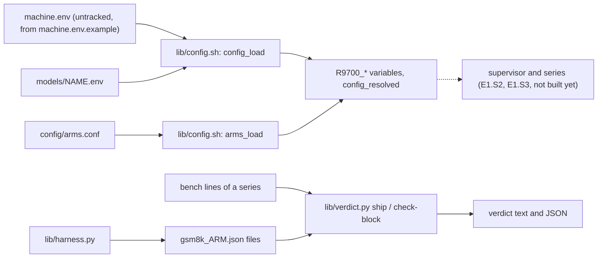

# Architecture — the R9700 vLLM tuning toolkit

Tune and measure vLLM on an AMD Radeon AI PRO R9700. This file describes what EXISTS. After E1.S1 that is the config layer,
the ship-test verdict, the quality harness and the test base; the supervisor, the guards, the series and `bin/r9700` are
planned (`todo/PLAN_r9700_tuning_toolkit.md`) and are not described here.

## Modules

| Module | Files | Purpose |
|---|---|---|
| Config | `lib/config.sh`, `machine.env.example`, `models/*.env`, `config/arms.conf` | one untracked `machine.env`, one `models/<name>.env` per model, one arm table; a bash loader validates every field before anything runs and never executes the files. Field list: `research/module_config.md` |
| Verdict | `lib/verdict.py` | the ship test over bench lines: complete arm-round blocks only, the base's spread over all its values, exact decimals, GSM8K within 2 x the larger stderr; `check-block` validates one arm-round record |
| Quality harness | `lib/harness.py` | 20 greedy prompts with logprobs, GSM8K scoring, and the two comparisons, against a running vLLM server; results are written atomically |
| Tests | `tests/`, `.github/workflows/tests.yml` | one runner for Python and bash tests, an owned run folder, the static checks. `research/module_tests.md` |

**Config.** `config_load <machine.env> <model.env>` parses both files line by line, applies the defaults of the field table,
checks every field and the three cross-field rules, and exports `R9700_<KEY>`. It prints every error in one pass
(`config: <file>:<line>: <KEY>: <problem>; legal: <legal>`) and returns 2. `config_keys` prints the field table; the
documentation and the example file are tested against it. The arm table gives, per arm, the serve arguments, the
environment and the extra mounts (`arm_args`, `arm_env`, `arm_mounts`, `arms_check`).

**Verdict.** `ship` reads bench lines in the grammar `<arm>-<round> <group> r=<n> <metric>: <value>`, splits them into
blocks per `<arm>-<round>`, keeps the last complete block of each, and names every other block. The base's spread at c=1 and
c=4 is max - min over its 3 rounds x 3 seeds; an arm passes on speed when its median is higher than the base's by more than
that spread at one concurrency and lower by more than it at none, and on quality when its GSM8K accuracy is within twice the
larger stderr. Exit 0 every arm decided, 1 an arm is incomplete, 2 an input error. The GSM8K files must be comparable: the same n for the arm and the base, at least 200 (`--min-gsm8k-n N` lowers the minimum and the output says so), and a stderr that matches sqrt(p(1-p)/n) of the file's own accuracy and n (within 0.00001), because the 2 x stderr limit is built from it; a forged stderr is refused with exit 2, a different or too small n leaves the arm incomplete.

**Quality harness.** `collect` runs the 20 prompts one at a time at temperature 0; `compare` finds where two runs diverge and
whether the divergences are near-ties; `gsm8k` scores a test file through the chat endpoint; `gsm8k-compare` applies the
2 x stderr limit. A result file is written to `<path>.part` and moved over the target.

## Flow

The dotted edge is the one thing that does not exist yet.
