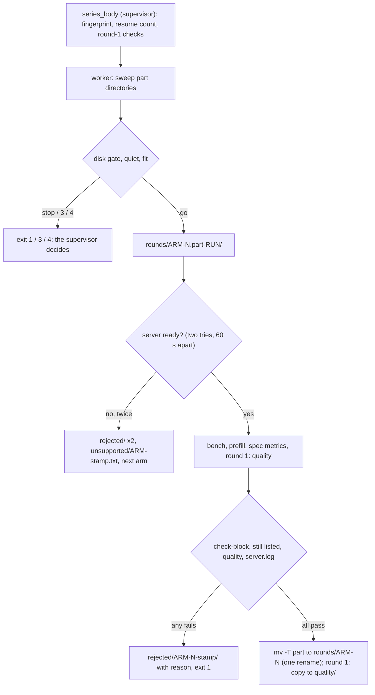
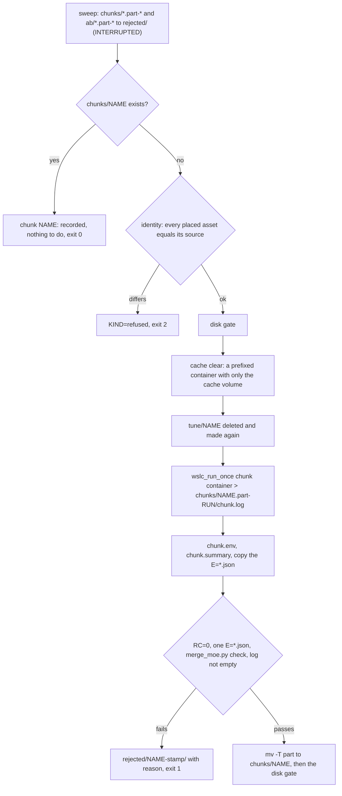
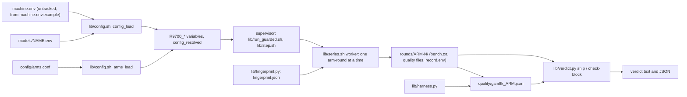

# Architecture — the R9700 vLLM tuning toolkit

Tune and measure vLLM on an AMD Radeon AI PRO R9700. This file describes what EXISTS. E1.S1 built the config layer, the ship-test verdict, the
quality harness and the test base. E1.S2 built the adapter seam (part (a)), the lock, the recovery marker, the worker gate and the restore (part (b)), and
the guards, the admission and the supervisor, `step`, `supervise`, `step_run` (part (c)). E1.S3 built the series: `bin/r9700 series` (arm-rounds recorded
only when complete, a run identity that a resume must match) and `bin/r9700 verdict` (the ship test read back from the records). E2.S1 built the pure
parts of MoE config tuning: the merge and check of chunk files, the kernel A/B table and decision, the coarse candidates and the vendored benchmark; they
have no command of their own yet. E2.S2 built the chunk and the A/B as workers, E2.S3 the verb `bin/r9700 moe-tune chunk|merge|activate|ab` that drives them
(with the merge record, the activation and the placed benchmark). What is still planned (E3) is in `todo/PLAN_r9700_tuning_toolkit.md`.

## Modules

| Module | Files | Purpose |
|---|---|---|
| Config | `lib/config.sh`, `machine.env.example`, `models/*.env`, `config/arms.conf` | one untracked `machine.env`, one `models/<name>.env` per model, one arm table; a bash loader validates every field before anything runs and never executes the files. Field list: `research/module_config.md` |
| Verdict | `lib/verdict.py` | the ship test over bench lines: complete arm-round blocks only, the base's spread over all its values, exact decimals, GSM8K within 2 x the larger stderr; `check-block` validates one arm-round record |
| Quality harness | `lib/harness.py` | 20 greedy prompts with logprobs, GSM8K scoring, and the two comparisons, against a running vLLM server; results are written atomically |
| Adapter | `lib/adapter.sh`, `lib/serve.sh`, `lib/bench.sh`, `lib/run_guarded.sh` (`t_scale` only so far) | the seam: every call to `wslc` and to Windows PowerShell is a function of `lib/adapter.sh`, under a ceiling that kills the child; `serve_start` and `bench_run` build the measured commands on it. Added by E1.S2 part (a) |
| Ownership and recovery | `bin/r9700` (`commands`, `init`, `verdict` as a restore-first shell), `lib/run_guarded.sh` (lock, session stop, worker start), `lib/worker_gate.sh`, `lib/restore.sh` | one run at a time on the GPU; the operator's server is restored once, ready, even after a hard kill. Added by E1.S2 part (b) |
| Supervisor and guards | `bin/r9700` (`step`), `lib/run_guarded.sh` (`supervise`, `cleanup_once`, outcome file, deadline, run folder), `lib/step.sh` (`step_run`), `lib/guard_quiet.sh`, `lib/guard_ram.sh`, `lib/guard_deadline.sh`, `lib/guard_common.sh`, `lib/disk_gate.sh`, `lib/wait_ready.sh` | one guarded step: wait until the PC is quiet, check the disk log, stop the operator's server (marker first), run the worker in its own session behind the gate, watch it (RAM, deadline), read its typed outcome, retry, and restore once at the end. Added by E1.S2 part (c) |
| Series and verdict | `bin/r9700` (`series`, `verdict`), `lib/series.sh`, `lib/fingerprint.py`, `lib/bench.sh` (`prefill_run`), `lib/serve.sh` (`container_name`, `serve_start --print`), `lib/adapter.sh` (`wslc_run_once`, `wslc_argv_text`) | `series <model> <arm>...` runs arm-rounds in alternating order as ONE step of the supervisor and records each arm-round only when it is complete, by one rename; the same command again resumes, and a resume whose effective experiment differs is refused naming what differs; `verdict <outdir>` prints the ship test over the final records. Added by E1.S3 |
| MoE pure parts (E2.S1) | `lib/merge_moe.py`, `lib/moe_kernel_ab.py`, `config/coarse_candidates.json`, `vendor/` | no container, no GPU. `merge_moe.py check` is the one definition of a valid chunk file; `merge` joins chunk dirs (and a base file) into a NEW file under `--out` and never replaces one. `moe_kernel_ab.py decide` turns the six logs of a kernel A/B into a table and one decision line. `vendor/benchmark_moe.py` is upstream vLLM plus three marked hooks, proven by its diff |
| MoE tuning (E2.S2) | `lib/moe.sh` (the chunk unit, the A/B unit, the cache clear), `lib/run_guarded.sh` (`cleanup_hook_set`, `_rg_cleanup_hook_run`), `config/coarse_candidates.json`, `vendor/benchmark_moe.py` | the two units of `tune_chunk.sh` and `moe_kernel_ab.sh` as WORKERS of one `step_run` each (`bash lib/moe.sh chunk …` / `ab …`); they take no lock, set no trap and never stop the operator's server. A record is made only when complete and valid. The Triton caches are cleared before every unit and in the exit path of the invocation by ONE hook of `cleanup_once`. The verb is E2.S3 (the next row) |
| MoE verb (E2.S3) | `bin/r9700` (`moe-tune`), `lib/moe_verb.sh` (`moe_place`, `moe_merge_verb`, `moe_activate_verb`, `moe_dry_run`), `lib/moe.sh` (the units it starts) | `moe-tune chunk\|merge\|activate\|ab <model> [options]`: the argument grammar is checked before the lock; `chunk` and `ab` are `supervise` around ONE `step_run`; `merge` is a reading verb (the lock only to restore first) that writes a new record `merged/<stamp>/` and replaces nothing; `activate` is `supervise` without a step (no admission) around an atomic swap of the exchange copy, refused while a server is listed. `vendor/benchmark_moe.py` and `config/coarse_candidates.json` are placed in `$WORK_DIR/r9700/` with their hashes checked before anything is stopped. Section *MoE verb* below |
| Tests | `tests/`, `.github/workflows/tests.yml` | one runner for Python and bash tests, an owned run folder, the static checks. `research/module_tests.md` |

**Config.** `config_load <machine.env> <model.env>` parses both files line by line, applies the defaults of the field table,
checks every field and the three cross-field rules, and exports `R9700_<KEY>`. It prints every error in one pass
(`config: <file>:<line>: <KEY>: <problem>; legal: <legal>`) and returns 2. `config_keys` prints the field table; the
documentation and the example file are tested against it. The arm table gives, per arm, the serve arguments, the
environment and the extra mounts (`arm_args`, `arm_env`, `arm_mounts`, `arms_check`).

**Adapter.** `lib/adapter.sh` is the only file that expands `$R9700_WSLC`, `$R9700_POWERSHELL` and `$R9700_RESTORE_SHELL`
(`bash tests/check_static.sh --seam` checks it). Every function runs one argv under `timeout --kill-after=5 <ceiling>` with standard
input from `/dev/null`, takes its numbers from `t_scale`, removes CRs, and returns the child's code, 124 at the ceiling, 2 for a bad
argument and 10 when it cannot call (`adapter: …`). A bare executable name is resolved on `PATH` at each call, an absolute path is used
as given. `restore_probe` runs one Python program in the server's container: `GET /v1/models` (5 s), then a one-token
`POST /v1/completions` (60 s). `serve_start` builds the argv of the old `serve.sh` from the config and calls `wait_ready`; `bench_run`
runs the six measured `vllm bench serve` runs and prints the tagged metric lines.

**Lock.** `lock_take <verb>` is `flock -n` on `<state dir>/lock`, descriptor 9, opened for append so a refused taker can read the holder line `<pid> <verb> <UTC time>` the winner wrote; the refusal is `r9700: another run holds <path>: pid <pid>, <verb>, since <time>`, exit 4. The state directory is `R9700_STATE_DIR`, else `${XDG_STATE_HOME:-$HOME/.local/state}/r9700`, made private (mode 700); it is not a config field, because the lock and the marker must work when the config is broken. The kernel frees the lock at a `SIGKILL`; every child the supervisor starts has descriptor 9 closed (`worker_start`, every adapter call), or a surviving child would keep it.

**Recovery marker.** `<state dir>/recovery.env`, a `KEY=VALUE` file in the config grammar, written with `.part` and `mv`. First write, before the operator's server is stopped (`marker_write_base`): the marker version, the run id, the time, the server's name and whether it was running, the executables, the start script and arguments, the container prefix, the readiness timeout, and `RUN_DIR` (the run's folder, so a restore after a hard kill saves its log tails beside the run's evidence). Second write, once the worker runs (`marker_add_worker`): `WORKER_PGID`, `WORKER_START_TICKS`, `BOOT_ID`, all three together. The worker starts as `setsid lib/worker_gate.sh <gate> <cmd...>` and waits at the gate (30 s, then exit 5, a failed try for the supervisor; 4 is the series worker's "nothing more fits before the deadline", A21); the gate file is created only after the second write is durable, so a worker never works before a restore could find it. The marker is removed only after the restore is ready, or, for a server that was not running, after every prefixed container is stopped.

**Restore.** `restore_from_marker <marker> <run dir>` needs no config: it stops the worker's whole SESSION when the process is provably the recorded one (same boot id; a leader with the recorded start ticks, or no leader at all, never a live leader with other ticks), saves a 200-line tail of every prefixed container and stops it (the container list and every stop are tried up to 3 times, a scaled 10 s apart: a transient fault of `wslc` must not leave the server down; only the third failure is the contract line `r9700: restore: <name> not ready after <n> s (<reason>)`, A22), then — when the server was running before — starts it unless it is listed and waits until `/v1/models` answers and a one-token completion succeeds (`ready_wait`, every 10 s up to `READY_TIMEOUT_S`, three misses of the container listing end it at once). A restore that is not ready is exit 5 with the one line `r9700: restore: <name> not ready after <n> s (<last probe result>)`, the marker kept and the server left as it is. Every adapter call of the supervisor runs under `timeout` started in the background; after a ceiling its whole process group gets `KILL` (amendment A12).

**The step (E1.S2 part (c)).** `bin/r9700 step [--show-deadline] [--model <file or name>] <label> -- <command...>` is `supervise step prepare_run step_run <label> -- <command...>`. The label is checked against `^[a-z0-9][a-z0-9-]{0,39}$` with the other arguments, before the lock. `supervise <verb> <prepare> <body> [args]` takes the lock, restores from a marker (restore-first), calls `<prepare>` (the config; refused: exit 2), computes the deadline (`T_END = min(next DEADLINE, now + MAX_RUN_MINUTES·60)`, `T_STOP = T_END − CLEANUP_BUDGET_S`, whole seconds rounded down, refused when `T_STOP` is under 60 s away), makes the run folder, installs the `INT`, `TERM` and `HUP` traps, runs the body and ends with the ONE `cleanup_once`. `step_run` runs one step and neither restores nor releases the lock, so a body of several `step_run` calls restores once at the end. `--show-deadline` prints `T_END`, `T_STOP` and `START=ok|refused (<why>)` and takes no lock.

`step_run` is a loop. (1) A quiet wait of at most 900 s and at most the time to `T_STOP` (`quiet_wait`: `R9700_QUIET_CHECKS` quiet checks in a row, 300 s apart; an unreadable load, or a missing `pgrep` while a busy pattern is set, is "not quiet"; every check line in the supervisor log ends with `quiet-checks=<k>/<n>` and, when another check will follow, `next check in <s> s`, in production seconds). A wait that ends not quiet restores the server first when we stopped it (decision 15) and waits again. (2) The disk gate: a baseline at the first admission of the invocation, a check at every later one; a stop is exit 9. (3) Admission: at most `MAX_SERVER_STOPS` per invocation (exit 8 beyond), the recovery marker written BEFORE the stop (copied to `steps/<n>.marker` at once, as evidence if the supervisor dies before the worker starts), the stop of the operator's server when it is listed, the worker started as `setsid lib/worker_gate.sh steps/<n>.gate <command...>` (the supervisor checks that it is its own session leader), the worker keys added to the marker, the evidence copy `steps/<n>.marker` replaced by a copy WITH the worker keys that keeps the time of the first write (before the stop), the RAM guard and the deadline watcher started, the gate file made. An admission counts against `MAX_SERVER_STOPS` once the container list answered (a failed list is a failed try, not a stop). (4) wait for the worker (a loop with its own ceiling: the worker's session is stopped a minute after `T_STOP` if the watcher is gone); the guards are stopped, as whole process trees, and the descendants that lead a process group of their own get the group `KILL`; after a guard or the deadline stopped the step, every prefixed container is stopped AGAIN (the guard may have been killed in the middle of its second container, and a retry must not start next to a live one); whatever is left of the worker's SESSION is stopped; the typed outcome `steps/<n>.outcome` (`KIND` one of `worker`, `ram_guard`, `disk_gate`, `deadline`, `interrupted`, `refused`; `RC`, `DETAIL`, `ENDED_AT`) is created exclusively, so the first writer — the RAM guard, the deadline watcher, the worker itself for the disk gate, or the supervisor after `wait` — wins. (5) The outcome decides: `worker 0` done; `worker 3` waits (not a failed try) with the server kept down for one quiet wait; `worker 4` and `deadline` exit 6; `refused` (the typed outcome a worker writes when it refuses to go on, E1.S3) exit 2 without a retry; `disk_gate` exit 9; anything else is a failed try, and `MAX_FAILED_TRIES` of them are exit 7.

A guard is a background fork of the supervisor with descriptor 9 closed. It writes the outcome FIRST, then stops every prefixed container (log tail saved before the stop) and then the worker's whole session by session id (`TERM`, the grace, `KILL`): GNU `timeout` gives every adapter call a process group of its own inside the worker's session, so a group kill would miss a call in flight (amendment A8). A guard ends by itself when the worker's leader (same start ticks) is gone, and runs without `R9700_T_STOP`: its work is cleanup-phase work. The RAM guard reads every 15 s; below `RAM_MIN_MB` is a stop, exactly at it is fine; a read that is not an integer is a miss, and three in a row are a stop (`telemetry unreadable 3 times`). The supervisor's step-phase adapter calls and the worker's run with `R9700_T_STOP` set (amendment A9); the cleanup phase runs without it (decision 8).

`cleanup_once <kind>` runs once per invocation (a flag; the second call returns the first one's result). It ignores `INT`, `TERM` and `HUP` from its first line, BEFORE it sets the flag, then: stops the guards, stops the worker's session, stops every prefixed container (when a worker ever started), restores the operator's server when a marker stands (not again when a restore of this invocation already failed: the marker stays), writes `<run dir>/status` (`done`, `failed`, `deadline`, `interrupted`, `restore-failed`, `not-quiet`, `disk-gate`; `running` while the run lives) and releases the lock. The handler of `INT`, `TERM` and `HUP` writes `KIND=interrupted` to the running step's outcome, runs `cleanup_once interrupted`, prints `r9700: interrupted, restored` and exits 130, 143 or 129; an `EXIT` trap runs the same cleanup for an `exit` in a body. Bash holds a trapped signal until a foreground command ends, so the supervisor's own waits are background jobs (`_rg_sleep`, `_rg_run`): a `TERM` ends a sleep or an adapter call of the admission at once (the call's whole process group is killed). The restore inside a run (decision 15) and the readiness sleep are foreground: a signal waits for the current call, at most its ceiling.

**MoE pure parts (E2.S1).** Three files with no side effects beyond their own output, so every rule of tuning that can be checked without a GPU is checked in CI.

- `lib/merge_moe.py check --keys "<bs…>" <file>` parses one chunk file (`{"triton_version": v, "<batch size>": {config}}`): JSON, a `triton_version`, keys that are positive integers
  written once, every config holding the six fields (`FIELDS`; more are allowed, `waves_per_eu` and `SPLIT_K` are), and exactly the promised keys. Exit 0, or 1 with the first problem on stdout.
- `lib/merge_moe.py merge --out <dir> [--base <file>] [--expect "<bs…>"] <chunk dir>…` reads every chunk dir (exactly one `E=*.json`, read back and never typed, and an optional `chunk.env` with
  `KEYS=` and the identity words `IMAGE`, `MODEL_DIR`, `DTYPE`, `LAYER`), reports every problem in one pass (`merge: …`, exit 2), and writes `<out>/<NAME>` in the sources' format. The expected key
  set is the base's keys plus each chunk's `KEYS=` promise (what the chunk holds when it has no `chunk.env`; a `chunk.env` without `KEYS=` is refused); `--expect` replaces it. An identity word set in some chunks and not in others is refused. The write goes to `<NAME>.part-<pid>-<start ticks>` and is
  moved with `os.link`, which fails when the name exists: **a merge never replaces a file** (append-only; which file a server reads is a separate step). A part whose owner is gone is removed
  before the next write; a part whose owner lives is a refusal. Where hard links fail, the write takes a `<NAME>.claim` (`O_EXCL`, owner inside, swept when dead) around check and replace.
- `lib/moe_kernel_ab.py decide <dir> --keys … --rule each|median --rule-keys …` takes the median of `reps` values per batch size and arm (a rep is a log: every log must be there and hold each batch size once) (exact decimals, strict comparison with the threshold),
  prints the table, one config line per arm and batch size, and `KERNEL: faster|not faster (<why>)`. Exit 0 faster, 1 not faster, 2 not decidable (a missing rep is `incomplete:`, nothing on stdout).
- `vendor/benchmark_moe.py`: see `vendor/README.md` (upstream commit and hash, the three hooks, the diff). `config/coarse_candidates.json`: 82 configs, the 81-config product plus the batch-size-1 winner.

```mermaid
sequenceDiagram
  participant S as supervise (bin/r9700 step)
  participant G as guards (RAM, deadline)
  participant W as worker (own session)
  participant P as operator's server
  S->>S: lock, restore from a marker, config, deadline, run folder
  loop step_run until done or a final code
    S->>S: quiet wait (restore the server first if it is down and the PC is busy)
    S->>S: disk gate (baseline or check)
    S->>S: marker written, copied; stop the server; admitted
    S->>W: setsid worker_gate.sh steps/n.gate cmd, marker gets the worker keys
    S->>G: guards started, then the gate file is made
    W-->>S: exit code (or a guard wrote the outcome and stopped the session)
    S->>S: guards stopped, session stopped, outcome settled
  end
  S->>S: cleanup_once: session, containers (tails first), restore, marker removed, status, lock
  S->>P: start script, readiness probe (once)
```

**Exit codes of `bin/r9700`** (E1.S2 parts (b) and (c)):

| Exit | Meaning | Line on stderr |
|---|---|---|
| 0 | done | — |
| 1 | `verdict`: at least one arm is INCOMPLETE (`verdict.py`'s own code; an input error, or a base with no final record, is 2) | the `verdict <arm>: INCOMPLETE (…)` line on stdout |
| 2 | config or arguments refused | S1's `config: …` lines, `deadline: only <n> s remain before the cleanup budget`, or `r9700: <verb>: …` |
| 4 | another run holds the lock | `r9700: another run holds <path>: pid <pid>, <verb>, since <time>` |
| 5 | the restore did not become ready | `r9700: restore: <name> not ready after <n> s (<last probe result>)` |
| 6 | the deadline or `MAX_RUN_MINUTES` stopped the step, or the worker said nothing more fits (worker 4) | `r9700: deadline: step stopped at <time>, <n> units done` (n: steps of this invocation that ended done) |
| 2 (series) | the series worker refused to go on (outcome `KIND=refused`): the identity of the series changed between two arm-rounds or start tries | `r9700: the worker refused to go on: fingerprint differs: <path>: <old> -> <new>` |
| 7 | the step failed `MAX_FAILED_TRIES` times | `r9700: step failed <n> times, last: <KIND> <DETAIL>` |
| 8 | not quiet before the deadline, or the server-stop budget is used | `r9700: not quiet before the deadline` / `r9700: admitted <n> times (each admission stops the operator's server), limit MAX_SERVER_STOPS=<n>` |
| 9 | the disk gate stopped the run | `r9700: disk gate: <its line>` |
| 10 | `init` found a problem | `init: <check>: <problem>` |
| 11 | the recovery marker cannot be read | `marker: <file>:<line>: …`, then `r9700: recovery marker <file> is unreadable: check the operator's server by hand, then remove <file>` |
| 129 / 130 / 143 | interrupted by `HUP` / `INT` / `TERM`; cleanup and restore ran | `r9700: interrupted, restored` |

**Growth surfaces of part (c).** `<RESULTS_DIR>/runs/<UTC stamp>-<pid>/` holds one invocation: `status`, `supervisor.log`, `disk_gate.state`, `steps/<n>.{gate,worker.log,outcome,marker,ram_guard.log,deadline.log}` and `guard/<stamp>-<container>.tail.log`. It is collected data: append-only, never removed or trimmed by the toolkit; its owner is the operator, who deletes a folder by hand when the run is no longer evidence. The per-call output files `.call.<pid>.<n>` live in it for the length of one call and are removed after it.

**Growth surfaces of part (b).** `<state dir>/restore-<run id>/` holds the log tails of a restore after a hard kill when the marker has no run folder of its own. Its owner is `init`: it keeps the newest 10 (by modification time) and removes older ones by exact name (`restore-` and a valid run id; never by prefix alone, never a link, never a file). The lock file and the marker are single files, rewritten, not grown. Readiness is bounded by `READY_TIMEOUT_S` and cut by its own stop time (amendment A13; both readiness loops, `ready_wait` and `wait_ready`, sleep through `sleep_in_window`, so the last sleep is cut to what the window has left and the wait ends when the window does, not a whole interval later), so the cleanup budget `READY_TIMEOUT_S + 300` holds it.

**Series (E1.S3).** `bin/r9700 series <model> <arm>... [--out <name>] [--rounds <1..20>] [--dry-run]` is `supervise series series_prepare series_body`. The arguments are checked before the lock; `series_prepare` loads the config, the arm table and the arms (an arm that is not in `config/arms.conf`, a mount that is missing, or a name too long for a container label are exit 2). `series_body` runs in the supervisor, BEFORE admission: (1) the fingerprint (a fingerprint is never built over records: `rounds/` or `rejected/` without a `fingerprint.json` is exit 2, naming the remedy, a new `--out` name); (2) `--dry-run` runs the same checks and prints the resolved commands of the first arm-round and ends, writing NOTHING in the outdir (no `fingerprint.json`, no merge of a new arm or more rounds, not even the folder: a dry run never changes a series); (3) the quality copies are synchronised; (4) the arm-rounds without a final record or an `unsupported/` mark are counted, and when none is left `series: <done> of <all> arm-rounds recorded, nothing to do` ends the invocation without admitting; (5) when round 1 has an arm-round to run, `harness.py` is copied to `<WORK_DIR>/r9700/` (hash checked) and the GSM8K data is checked; (6) `step_run series -- bash lib/series.sh <outdir> <rounds> <arm>...`: the whole series is ONE step, so the operator's server is stopped once and restored once. A refused resume, an empty listing and a missing GSM8K file are therefore exit 2 with nothing stopped. The throwaway container of the fingerprint runs through `_rg_run` like every other supervisor call, so a `TERM` during it ends it at once (143).

*The fingerprint* is `<outdir>/fingerprint.json`, `{"version": 1, "sha256", "components"}`; the hash is over the canonical form of `components` (`sort_keys`, compact, ASCII). Components: the model's fields (directory, served name, context, sequences, GPU fraction, extra arguments, tuned folder, mounts), the SHA-256 of the model's file listing (names and sizes from a throwaway container, `wslc run --rm`: no weights are read, so a same-size edit of a weight file is not seen) and of the generation config (every file under `/genconfig`, nested and hidden included), the image tag, the hash of every patch file of the model and of the arms, every arm's arguments, environment and mounts, the base arm, the workload constants, the round count, the hash of every module a unit runs (`tools`, A24: the shell libraries the worker sources, `lib/series.sh` itself and the Python programs it calls, from the two lists `_SERIES_UNIT_SH` and `_SERIES_UNIT_PY` in `lib/series.sh`, which the worker's source loop uses too), and the container prefix and GSM8K path. `lib/series.sh` writes one input file per group; `lib/fingerprint.py` builds the JSON. A fingerprint document is read only when its `version` is supported and its `sha256` equals the digest recomputed from its `components` (compare, show, `--probe-from`, so the series start and the verdict too): an edited or damaged file is exit 2 naming the file, never a silent identity. On an existing outdir `compare --merge` prints one line per differing leaf, `fingerprint differs: <dotted path>: <old> -> <new>`, and the series refuses (exit 2, the lines on stderr). A new arm and a larger round count are extensions (`fingerprint: arm <name> added`, `fingerprint: rounds extended <old> -> <new>`; the stored file is rewritten atomically): an arm-round record depends on its own arm, round, model, image, patches and workload, not on which other arms exist or how many rounds were asked for. An arm left out of a later invocation is not a difference; another base and fewer rounds are. The fingerprint is computed ONCE by the supervisor, but one step can restart the worker many times, hours apart, while the worker re-reads `arms.conf` and the containers mount the patch files live; so the worker re-checks the cheap components (config, arms, patches, tools; `fingerprint.py build --probe-from <stored>` takes the model listing and the generation config from the stored file, the throwaway container is not run again) at the start of EVERY arm-round, after the gate and before its server starts. The identity is checked at each unit start and before each start try; an edit during a running unit is seen by the next unit; final records are not re-judged. A difference prints the `fingerprint differs` lines, writes `KIND=refused RC=2` to the outcome, and the supervisor reads that typed outcome as a refusal (`r9700: the worker refused to go on: <lines>`, exit 2, no retry, one restore); a plain exit 2 of a step command without that outcome stays a failed try (S2 decision 6), the worker gate's own bad-arguments exit 2 included; the arm-round has no record and no `rejected/` attempt.

*The worker* (`lib/series.sh` run as the step's command) sweeps first: a `rounds/*.part-*` directory an earlier worker left is moved to `rejected/` with an `INTERRUPTED` reason, never trusted. Then, per `round`, per `arm` (so the arms alternate inside a round): skip a final record or an unsupported arm; the disk gate (a stop writes `KIND=disk_gate`, exit 1); the quiet check (not quiet: `NOT QUIET: <arm> round <n>`, exit 3, the supervisor waits and admits again); the fit check (`now + R9700_ARM_SECONDS (default 1500) > T_STOP`: exit 4, which the supervisor reads as the deadline, exit 6, not as a failed try); the identity re-check (above; exit 2); `rounds/<arm>-<round>.part-<run id>/`; the server start (`serve_start`, the tuned MoE folder first and the arm's own environment after it, so the arm's wins); a start that fails is stopped, kept in `rejected/` with its log, and retried once 60 s later under the container name `<label>-r2`; a second failure writes `unsupported/<arm>-<UTC stamp>.txt` (the last three `Error` lines and the two rejected paths) and the series goes on. Then `server_config.txt`, `bench_run` and `prefill_run` into `bench.txt` (36 lines for two prefill lengths), `spec_metrics.txt`, and in round 1 the two quality files (`collect`, `gsm8k` through `/work/r9700/harness.py`, moved in from `<WORK_DIR>/r9700/<series>/`). The validation: (a) `verdict.py check-block` accepts `bench.txt` (the ONE definition of complete), (b) the container is still listed, (c) in round 1 `fingerprint.py check-quality` accepts the two files, (d) `server.log` is not empty. The record becomes final by `mv -T <part> rounds/<arm>-<round>`, one `rename(2)`; a failed validation moves the directory to `rejected/<arm>-<round>-<stamp>/` with a `reason` (`LOST: server alive 0` or `REJECTED: server alive 1`, then one `check-block:`, `quality:` or `server.log:` line per problem) and the worker exits 1, a failed try for the supervisor. After the rename the round-1 `gsm8k_<arm>.json` is copied to `quality/` (a copy, not a link) and `series_quality_sync` restores a missing copy at the next start. `series.sh` sets no trap and never stops the operator's server.



*The verdict.* `bin/r9700 verdict <outdir> [--base <arm>] [--no-quality] [--json <file>]` (after the restore-first half of S2) prints `series <outdir>: base <arm>, <n> rounds, fingerprint <12 hex>`, the one-round note (`note: 1 round, 3 values per concurrency; the recorded ship test used 3 rounds (9)`), one `verdict <arm>: UNSUPPORTED (did not start twice, <stamp>)` line per unsupported arm, an `invoking:` line with the `verdict.py ship` argv, and then `verdict.py`'s output and exit code. It passes only the final `rounds/<arm>-<round>/bench.txt` files, so a part directory or a rejected attempt never reaches it, and never the base as an arm. An unsupported base is exit 2; a base with no final record is exit 2 (`base arm "<arm>" has no complete arm-round in the inputs`); an arm with a missing round is INCOMPLETE, never PASS or FAIL.

**Growth surfaces of E1.S3.** `<RESULTS_DIR>/<name>/` (the series outdir) holds `fingerprint.json` (≈10 KB), `rounds/<arm>-<round>/` (`bench.txt` ≈3 KB, `spec_metrics.txt` ≈2 KB, `server.log` ≈300 KB, `server_config.txt` ≈1 KB, `record.env`, and in round 1 `prompts_<arm>.json` ≈250 KB and `gsm8k_<arm>.json` ≈100 KB), `quality/` (the GSM8K copies, ≈100 KB per arm), `rejected/` (a failed or interrupted attempt, ≈300 KB each: at most `MAX_FAILED_TRIES` per invocation, and two per unsupported arm) and `unsupported/` (a few lines each). A 3-arm, 3-round series is about 4.2 MB plus the supervisor's run folders. It is collected data: append-only, never removed or trimmed by the toolkit; its owner is the operator. The throwaway fingerprint input folder `.fingerprint-inputs.part-<run id>/` lives in the outdir for the length of one invocation and is removed by it, or by the next invocation after a kill.

**Order of every invocation** that can change the machine: arguments, lock, restore from a marker, config, deadline, work. `verdict` takes the lock only when a marker exists and releases it after the restore.

**Verdict.** `ship` reads bench lines in the grammar `<arm>-<round> <group> r=<n> <metric>: <value>`, splits them into
blocks per `<arm>-<round>`, keeps the last complete block of each, and names every other block. The base's spread at c=1 and
c=4 is max - min over its 3 rounds x 3 seeds; an arm passes on speed when its median is higher than the base's by more than
that spread at one concurrency and lower by more than it at none, and on quality when its GSM8K accuracy is within twice the
larger stderr. Exit 0 every arm decided, 1 an arm is incomplete, 2 an input error. The GSM8K files must be comparable: the same n for the arm and the base, at least 200 (`--min-gsm8k-n N` lowers the minimum and the output says so), and a stderr that matches sqrt(p(1-p)/n) of the file's own accuracy and n (within 0.00001), because the 2 x stderr limit is built from it; a forged stderr is refused with exit 2, a different or too small n leaves the arm incomplete.

**Quality harness.** `collect` runs the 20 prompts one at a time at temperature 0; `compare` finds where two runs diverge and
whether the divergences are near-ties; `gsm8k` scores a test file through the chat endpoint; `gsm8k-compare` applies the
2 x stderr limit. A result file is written to `<path>.part` and moved over the target.

## MoE tuning (E2.S2)

**The units.** `bash lib/moe.sh chunk <outdir> <model> <chunk> <layer> <search> <keys…>` runs ONE tuning chunk (layer `experts` or `draft`, search `full` or `coarse`), `bash lib/moe.sh ab <outdir> <model> <layer> <rule> "<rule keys>" <reps> "<keys>"` ONE kernel A/B. Each is the command of one `step_run` (so: one admission, the guards of E1, the typed outcome, the retries). Exit codes: 0 done (recorded, or already recorded: `chunk <name>: recorded, nothing to do`), 1 the unit failed (a rejected record is a failed try), 2 refused. A refusal by the identity check, by `MOE_DTYPE=none` or by an A/B without its merged file writes the outcome `KIND=refused`, so `step` stops at once (exit 2, no retry, one restore); a bad argument is a plain 2 with one `moe:` line. A unit whose container was cut by the stop time writes `KIND=deadline` (the deadline watcher may be first: the first writer wins) and leaves its part for the next start's sweep.

**The exchange folder.** The containers see `/work` only, so a chunk saves into `$WORK_DIR/r9700/moe/<model>/tune/<chunk>/` (container path `/work/r9700/moe/<model>/tune/<chunk>/`). It is scratch: deleted and made again before every run of that chunk (a half-written chunk holds no evidence, and a stale file there would pass `check`). The record is copied out of it. `merged/` in the same folder is what `activate` (E2.S3) fills and what the A/B's tuned arm reads.

**The record life cycle.**



`chunks/<chunk>/` holds the JSON under the name vLLM gave it, `chunk.log`, `chunk.summary` (the grep of `tune_chunk.sh` line 21), `chunk.env` (the keys it promised, the layer, the dtype, the identity hashes of the three placed files — `absent` for one that is not there — the image, the model directory, the run id and the times). The A/B record `ab/<stamp>/` holds `default-<rep>.log` and `tuned-<rep>.log` (one file per container, written once, never appended to: `decide` refuses a repeated key), `ab.env`, `summary.txt` and `decision.txt`. It is made only when every log holds one `Kernel time` line per key AND every tuned log shows `Using configuration from <B folder>/<B file> for MoE layer`: without the second rule a decision could compare the default config with itself. `decide` exiting 0 (faster) or 1 (not faster) are both complete records. The identity check iterates `moe_assets` (benchmark, candidates, harness) on EVERY unit, whatever the mode, and refuses a placed file that differs from its source in the repository.

**The cleanup hook.** `cleanup_hook_set <function>` registers one function (the MoE verb registers `moe_cache_clear` before `supervise`); `cleanup_once` runs it once, after `container_stop_all` and before the restore, and only when a step was admitted. It runs as a background fork of the supervisor under an ENFORCED ceiling (`t_ceiling 60` plus the 5 s grace, in wall time) and a fork still alive then is ended with `_rg_tree_kill`; the log line is `cleanup hook: <name> rc=<n>` or `cleanup hook: <name> timeout after <n> s, killed`. Neither changes the cleanup's result: the restore runs whatever the clear did. A foreground hook would be wrong: the cleanup ignores signals, so a call whose own ceiling does not hold would hang it before the restore. The clear container's own adapter ceiling (90 s) is deliberately LONGER than the supervisor's window, so the supervisor's is the outer, enforced one. **The budget rule** follows: `CLEANUP_BUDGET_S ≥ READY_TIMEOUT_S + 365` (300 for the restore, 65 for the hook), default 1565; `READY_TIMEOUT_S` tops out at 3235.

**Growth surfaces.** `<RESULTS_DIR>/moe-<model>/chunks/` ≈ 35 KB per chunk and `ab/` ≈ 25 KB per A/B, kept forever; `rejected/` ≈ 35 KB per rejected attempt (at most `MAX_FAILED_TRIES` per invocation), kept forever; a cut chunk's `.part-` goes there at the next worker start. The exchange folder `tune/<chunk>/` ≈ 1–3 KB, deleted before every run of that chunk. The Triton caches `triton-moe-tune` and `triton-moe-ab` in the cache volume grow by 0.5–1.3 GB per chunk and are cleared before every unit and by the hook; a hard-killed supervisor runs no hook, so the next unit's start is what clears them.

## MoE verb (E2.S3)

**One verb, four modes, one merge policy.** `bin/r9700 moe-tune <mode> <model> [options]` (the function is `verb_moe_tune`; `commands` prints the name with a hyphen).
The policy: a merge writes a new versioned record and replaces nothing; `activate` is the only step that changes what a server or an A/B reads, it is explicit,
atomic, keeps the previous file and is refused while a container that may read the folder is listed.

| Mode | Lifecycle | What it does |
|---|---|---|
| `chunk` | `supervise moe-tune moe_prepare moe_chunk_body` | `moe_place` (the files, hash-checked), the dry run, the count of a recorded chunk (before admission), `cleanup_hook_set moe_cache_clear`, `step_run moe-chunk -- bash lib/moe.sh chunk …` |
| `ab` | `supervise …` with `moe_ab_body` | the same order; `step_run moe-ab -- bash lib/moe.sh ab …`; prints the new record and its decision |
| `merge` | reading verb: the lock only when a marker exists, to restore first; then the config | `lib/merge_moe.py merge --out <outdir>/merged/<stamp>/ [--base <file>] <outdir>/chunks/<chunk>…`, then `merge.env` (`CHUNKS`, `BASE`, `BASE_SHA256`, `OUTPUT_SHA256`, `WRITTEN_AT`). `--base auto` is the file of the merged name in `TUNED_CONFIG_DIR` when that folder is under `/work` |
| `activate` | `supervise …` with `moe_activate_body`: lock, restore-first, config, the swap, the one cleanup; no `step_run`, so no admission, no marker and no cleanup hook | the record must hold one `E=*.json`; the listed containers are read (`wslc_list`) and the operator's server or any prefixed one refuses the swap unless `--force` (logged); stale `.part-<pid>-<ticks>` files of dead owners are swept; the active file is copied to `merged/previous/<UTC stamp>-<NAME>`; the record's file is written to a part beside the active one, fsynced and moved with `mv -T` (one `rename(2)`); `activate.env` is written the same way (`STAMP`, `NAME`, `SHA256`, `PREVIOUS`, `ACTIVATED_AT`, `FORCED`) |


The exit codes are the supervisor's table above; `moe-tune` adds none. Exit 2 also covers a bad argument (one `r9700: moe-tune: <mode>: …` line, before the lock),
`MOE_DTYPE=none` for the experts layer, a merge input error (`merge_moe.py`'s code) and an activation that is refused (not a record, or a server is listed); 4 is
another run holding the lock, 5 a restore-first that did not become ready.

**Placed files.** `moe_place` copies the `required` rows of `moe_assets` (`vendor/benchmark_moe.py`, `config/coarse_candidates.json`) to `$WORK_DIR/r9700/` through a `.part`
and a move when the hash differs, then checks the hash again; a failure is exit 2 before any stop. The worker checks them again on every unit (E2.S2 decision 8).

**Dry run.** `--dry-run` (chunk, ab) prints `dry-run: wslc run --rm --name …` lines built by the worker's own `moe_argv`, and the clear's line; it starts nothing and writes
no record or part. It does place the two files (a hash-checked copy).

**Growth surfaces.** `<RESULTS_DIR>/moe-<model>/merged/<stamp>/` ≈ 3 KB per merge, kept forever (a `.part-<pid>-<ticks>` of an interrupted merge stays in its own folder, never
reused). `<WORK_DIR>/r9700/moe/<model>/merged/` holds the active file and `activate.env` (≈ 3 KB) and `previous/<stamp>-<NAME>` ≈ 3 KB per activation, kept forever; a
part file of an activation killed in its window is removed by the next `activate` when its owner is dead. `<WORK_DIR>/r9700/benchmark_moe.py` (41 KB) and `coarse_candidates.json` (11 KB) are
replaced when `vendor/` changes.

## Flow


