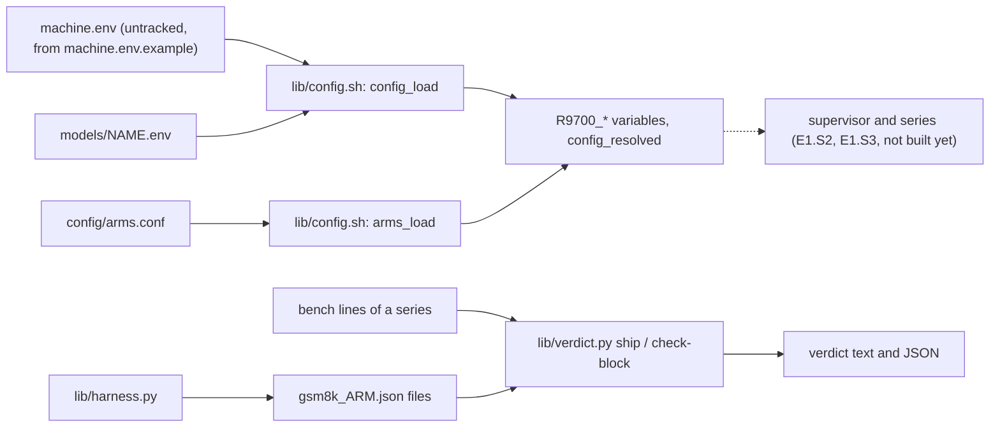

# Architecture — the R9700 vLLM tuning toolkit

Tune and measure vLLM on an AMD Radeon AI PRO R9700. This file describes what EXISTS. After E1.S1 that is the config layer,
the ship-test verdict, the quality harness and the test base; the supervisor, the guards, the series and `bin/r9700` are
planned (`todo/PLAN_r9700_tuning_toolkit.md`) and are not described here. E1.S2 part (a) has added the adapter seam, part (b) the lock, the recovery marker, the worker gate and the restore, part (c) the guards, the admission and the supervisor (`step`, `supervise`, `step_run`); the series (E1.S3) is not built yet.

## Modules

| Module | Files | Purpose |
|---|---|---|
| Config | `lib/config.sh`, `machine.env.example`, `models/*.env`, `config/arms.conf` | one untracked `machine.env`, one `models/<name>.env` per model, one arm table; a bash loader validates every field before anything runs and never executes the files. Field list: `research/module_config.md` |
| Verdict | `lib/verdict.py` | the ship test over bench lines: complete arm-round blocks only, the base's spread over all its values, exact decimals, GSM8K within 2 x the larger stderr; `check-block` validates one arm-round record |
| Quality harness | `lib/harness.py` | 20 greedy prompts with logprobs, GSM8K scoring, and the two comparisons, against a running vLLM server; results are written atomically |
| Adapter | `lib/adapter.sh`, `lib/serve.sh`, `lib/bench.sh`, `lib/run_guarded.sh` (`t_scale` only so far) | the seam: every call to `wslc` and to Windows PowerShell is a function of `lib/adapter.sh`, under a ceiling that kills the child; `serve_start` and `bench_run` build the measured commands on it. Added by E1.S2 part (a) |
| Ownership and recovery | `bin/r9700` (`commands`, `init`, `verdict` as a restore-first shell), `lib/run_guarded.sh` (lock, session stop, worker start), `lib/worker_gate.sh`, `lib/restore.sh` | one run at a time on the GPU; the operator's server is restored once, ready, even after a hard kill. Added by E1.S2 part (b) |
| Supervisor and guards | `bin/r9700` (`step`), `lib/run_guarded.sh` (`supervise`, `cleanup_once`, outcome file, deadline, run folder), `lib/step.sh` (`step_run`), `lib/guard_quiet.sh`, `lib/guard_ram.sh`, `lib/guard_deadline.sh`, `lib/guard_common.sh`, `lib/disk_gate.sh`, `lib/wait_ready.sh` | one guarded step: wait until the PC is quiet, check the disk log, stop the operator's server (marker first), run the worker in its own session behind the gate, watch it (RAM, deadline), read its typed outcome, retry, and restore once at the end. Added by E1.S2 part (c) |
| Tests | `tests/`, `.github/workflows/tests.yml` | one runner for Python and bash tests, an owned run folder, the static checks. `research/module_tests.md` |

**Config.** `config_load <machine.env> <model.env>` parses both files line by line, applies the defaults of the field table,
checks every field and the three cross-field rules, and exports `R9700_<KEY>`. It prints every error in one pass
(`config: <file>:<line>: <KEY>: <problem>; legal: <legal>`) and returns 2. `config_keys` prints the field table; the
documentation and the example file are tested against it. The arm table gives, per arm, the serve arguments, the
environment and the extra mounts (`arm_args`, `arm_env`, `arm_mounts`, `arms_check`).

**Adapter.** `lib/adapter.sh` is the only file that expands `$R9700_WSLC`, `$R9700_POWERSHELL` and `$R9700_RESTORE_SHELL`
(`bash tests/check_static.sh --seam` checks it). Every function runs one argv under `timeout --kill-after=5 <ceiling>` with standard
input from `/dev/null`, takes its numbers from `t_scale`, removes CRs, and returns the child's code, 124 at the ceiling, 2 for a bad
argument and 10 when it cannot call (`adapter: …`). A bare executable name is resolved on `PATH` at each call, an absolute path is used
as given. `restore_probe` runs one Python program in the server's container: `GET /v1/models` (5 s), then a one-token
`POST /v1/completions` (60 s). `serve_start` builds the argv of the old `serve.sh` from the config and calls `wait_ready`; `bench_run`
runs the six measured `vllm bench serve` runs and prints the tagged metric lines.

**Lock.** `lock_take <verb>` is `flock -n` on `<state dir>/lock`, descriptor 9, opened for append so a refused taker can read the holder line `<pid> <verb> <UTC time>` the winner wrote; the refusal is `r9700: another run holds <path>: pid <pid>, <verb>, since <time>`, exit 4. The state directory is `R9700_STATE_DIR`, else `${XDG_STATE_HOME:-$HOME/.local/state}/r9700`, made private (mode 700); it is not a config field, because the lock and the marker must work when the config is broken. The kernel frees the lock at a `SIGKILL`; every child the supervisor starts has descriptor 9 closed (`worker_start`, every adapter call), or a surviving child would keep it.

**Recovery marker.** `<state dir>/recovery.env`, a `KEY=VALUE` file in the config grammar, written with `.part` and `mv`. First write, before the operator's server is stopped (`marker_write_base`): the marker version, the run id, the time, the server's name and whether it was running, the executables, the start script and arguments, the container prefix, the readiness timeout, and `RUN_DIR` (the run's folder, so a restore after a hard kill saves its log tails beside the run's evidence). Second write, once the worker runs (`marker_add_worker`): `WORKER_PGID`, `WORKER_START_TICKS`, `BOOT_ID`, all three together. The worker starts as `setsid lib/worker_gate.sh <gate> <cmd...>` and waits at the gate (30 s, then exit 4); the gate file is created only after the second write is durable, so a worker never works before a restore could find it. The marker is removed only after the restore is ready, or, for a server that was not running, after every prefixed container is stopped.

**Restore.** `restore_from_marker <marker> <run dir>` needs no config: it stops the worker's whole SESSION when the process is provably the recorded one (same boot id; a leader with the recorded start ticks, or no leader at all, never a live leader with other ticks), saves a 200-line tail of every prefixed container and stops it, then — when the server was running before — starts it unless it is listed and waits until `/v1/models` answers and a one-token completion succeeds (`ready_wait`, every 10 s up to `READY_TIMEOUT_S`, three misses of the container listing end it at once). A restore that is not ready is exit 5 with the one line `r9700: restore: <name> not ready after <n> s (<last probe result>)`, the marker kept and the server left as it is. Every adapter call of the supervisor runs under `timeout` started in the background; after a ceiling its whole process group gets `KILL` (amendment A12).

**The step (E1.S2 part (c)).** `bin/r9700 step [--show-deadline] [--model <file or name>] <label> -- <command...>` is `supervise step prepare_run step_run <label> -- <command...>`. The label is checked against `^[a-z0-9][a-z0-9-]{0,39}$` with the other arguments, before the lock. `supervise <verb> <prepare> <body> [args]` takes the lock, restores from a marker (restore-first), calls `<prepare>` (the config; refused: exit 2), computes the deadline (`T_END = min(next DEADLINE, now + MAX_RUN_MINUTES·60)`, `T_STOP = T_END − CLEANUP_BUDGET_S`, whole seconds rounded down, refused when `T_STOP` is under 60 s away), makes the run folder, installs the `INT`, `TERM` and `HUP` traps, runs the body and ends with the ONE `cleanup_once`. `step_run` runs one step and neither restores nor releases the lock, so a body of several `step_run` calls restores once at the end. `--show-deadline` prints `T_END`, `T_STOP` and `START=ok|refused (<why>)` and takes no lock.

`step_run` is a loop. (1) A quiet wait of at most 900 s and at most the time to `T_STOP` (`quiet_wait`: `R9700_QUIET_CHECKS` quiet checks in a row, 300 s apart; an unreadable load, or a missing `pgrep` while a busy pattern is set, is "not quiet"). A wait that ends not quiet restores the server first when we stopped it (decision 15) and waits again. (2) The disk gate: a baseline at the first admission of the invocation, a check at every later one; a stop is exit 9. (3) Admission: at most `MAX_SERVER_STOPS` per invocation (exit 8 beyond), the recovery marker written BEFORE the stop (copied to `steps/<n>.marker` at once, as evidence if the supervisor dies before the worker starts), the stop of the operator's server when it is listed, the worker started as `setsid lib/worker_gate.sh steps/<n>.gate <command...>` (the supervisor checks that it is its own session leader), the worker keys added to the marker, the evidence copy `steps/<n>.marker` replaced by a copy WITH the worker keys that keeps the time of the first write (before the stop), the RAM guard and the deadline watcher started, the gate file made. An admission counts against `MAX_SERVER_STOPS` once the container list answered (a failed list is a failed try, not a stop). (4) wait for the worker (a loop with its own ceiling: the worker's session is stopped a minute after `T_STOP` if the watcher is gone); the guards are stopped, as whole process trees, and the descendants that lead a process group of their own get the group `KILL`; after a guard or the deadline stopped the step, every prefixed container is stopped AGAIN (the guard may have been killed in the middle of its second container, and a retry must not start next to a live one); whatever is left of the worker's SESSION is stopped; the typed outcome `steps/<n>.outcome` (`KIND`, `RC`, `DETAIL`, `ENDED_AT`) is created exclusively, so the first writer — the RAM guard, the deadline watcher, the worker itself for the disk gate, or the supervisor after `wait` — wins. (5) The outcome decides: `worker 0` done; `worker 3` waits (not a failed try) with the server kept down for one quiet wait; `worker 4` and `deadline` exit 6; `disk_gate` exit 9; anything else is a failed try, and `MAX_FAILED_TRIES` of them are exit 7.

A guard is a background fork of the supervisor with descriptor 9 closed. It writes the outcome FIRST, then stops every prefixed container (log tail saved before the stop) and then the worker's whole session by session id (`TERM`, the grace, `KILL`): GNU `timeout` gives every adapter call a process group of its own inside the worker's session, so a group kill would miss a call in flight (amendment A8). A guard ends by itself when the worker's leader (same start ticks) is gone, and runs without `R9700_T_STOP`: its work is cleanup-phase work. The RAM guard reads every 15 s; below `RAM_MIN_MB` is a stop, exactly at it is fine; a read that is not an integer is a miss, and three in a row are a stop (`telemetry unreadable 3 times`). The supervisor's step-phase adapter calls and the worker's run with `R9700_T_STOP` set (amendment A9); the cleanup phase runs without it (decision 8).

`cleanup_once <kind>` runs once per invocation (a flag; the second call returns the first one's result). It ignores `INT`, `TERM` and `HUP` from its first line, BEFORE it sets the flag, then: stops the guards, stops the worker's session, stops every prefixed container (when a worker ever started), restores the operator's server when a marker stands (not again when a restore of this invocation already failed: the marker stays), writes `<run dir>/status` (`done`, `failed`, `deadline`, `interrupted`, `restore-failed`, `not-quiet`, `disk-gate`; `running` while the run lives) and releases the lock. The handler of `INT`, `TERM` and `HUP` writes `KIND=interrupted` to the running step's outcome, runs `cleanup_once interrupted`, prints `r9700: interrupted, restored` and exits 130, 143 or 129; an `EXIT` trap runs the same cleanup for an `exit` in a body. Bash holds a trapped signal until a foreground command ends, so the supervisor's own waits are background jobs (`_rg_sleep`, `_rg_run`): a `TERM` ends a sleep or an adapter call of the admission at once (the call's whole process group is killed). The restore inside a run (decision 15) and the readiness sleep are foreground: a signal waits for the current call, at most its ceiling.

```mermaid
sequenceDiagram
  participant S as supervise (bin/r9700 step)
  participant G as guards (RAM, deadline)
  participant W as worker (own session)
  participant P as operator's server
  S->>S: lock, restore from a marker, config, deadline, run folder
  loop step_run until done or a final code
    S->>S: quiet wait (restore the server first if it is down and the PC is busy)
    S->>S: disk gate (baseline or check)
    S->>S: marker written, copied; stop the server; admitted
    S->>W: setsid worker_gate.sh steps/n.gate cmd, marker gets the worker keys
    S->>G: guards started, then the gate file is made
    W-->>S: exit code (or a guard wrote the outcome and stopped the session)
    S->>S: guards stopped, session stopped, outcome settled
  end
  S->>S: cleanup_once: session, containers (tails first), restore, marker removed, status, lock
  S->>P: start script, readiness probe (once)
```

**Exit codes of `bin/r9700`** (E1.S2 parts (b) and (c)):

| Exit | Meaning | Line on stderr |
|---|---|---|
| 0 | done | — |
| 2 | config or arguments refused | S1's `config: …` lines, `deadline: only <n> s remain before the cleanup budget`, or `r9700: <verb>: …` |
| 4 | another run holds the lock | `r9700: another run holds <path>: pid <pid>, <verb>, since <time>` |
| 5 | the restore did not become ready | `r9700: restore: <name> not ready after <n> s (<last probe result>)` |
| 6 | the deadline or `MAX_RUN_MINUTES` stopped the step, or the worker said nothing more fits (worker 4) | `r9700: deadline: step stopped at <time>, <n> units done` (n: steps of this invocation that ended done) |
| 7 | the step failed `MAX_FAILED_TRIES` times | `r9700: step failed <n> times, last: <KIND> <DETAIL>` |
| 8 | not quiet before the deadline, or the server-stop budget is used | `r9700: not quiet before the deadline` / `r9700: server stopped <n> times, limit MAX_SERVER_STOPS=<n>` |
| 9 | the disk gate stopped the run | `r9700: disk gate: <its line>` |
| 10 | `init` found a problem | `init: <check>: <problem>` |
| 11 | the recovery marker cannot be read | `marker: <file>:<line>: …`, then `r9700: recovery marker <file> is unreadable: check the operator's server by hand, then remove <file>` |
| 129 / 130 / 143 | interrupted by `HUP` / `INT` / `TERM`; cleanup and restore ran | `r9700: interrupted, restored` |

**Growth surfaces of part (c).** `<RESULTS_DIR>/runs/<UTC stamp>-<pid>/` holds one invocation: `status`, `supervisor.log`, `disk_gate.state`, `steps/<n>.{gate,worker.log,outcome,marker,ram_guard.log,deadline.log}` and `guard/<stamp>-<container>.tail.log`. It is collected data: append-only, never removed or trimmed by the toolkit; its owner is the operator, who deletes a folder by hand when the run is no longer evidence. The per-call output files `.call.<pid>.<n>` live in it for the length of one call and are removed after it.

**Growth surfaces of part (b).** `<state dir>/restore-<run id>/` holds the log tails of a restore after a hard kill when the marker has no run folder of its own. Its owner is `init`: it keeps the newest 10 (by modification time) and removes older ones by exact name (`restore-` and a valid run id; never by prefix alone, never a link, never a file). The lock file and the marker are single files, rewritten, not grown. Readiness is bounded by `READY_TIMEOUT_S` and cut by its own stop time (amendment A13), so the cleanup budget `READY_TIMEOUT_S + 300` holds it.

**Order of every invocation** that can change the machine: arguments, lock, restore from a marker, config, deadline, work. `verdict` takes the lock only when a marker exists and releases it after the restore.

**Verdict.** `ship` reads bench lines in the grammar `<arm>-<round> <group> r=<n> <metric>: <value>`, splits them into
blocks per `<arm>-<round>`, keeps the last complete block of each, and names every other block. The base's spread at c=1 and
c=4 is max - min over its 3 rounds x 3 seeds; an arm passes on speed when its median is higher than the base's by more than
that spread at one concurrency and lower by more than it at none, and on quality when its GSM8K accuracy is within twice the
larger stderr. Exit 0 every arm decided, 1 an arm is incomplete, 2 an input error. The GSM8K files must be comparable: the same n for the arm and the base, at least 200 (`--min-gsm8k-n N` lowers the minimum and the output says so), and a stderr that matches sqrt(p(1-p)/n) of the file's own accuracy and n (within 0.00001), because the 2 x stderr limit is built from it; a forged stderr is refused with exit 2, a different or too small n leaves the arm incomplete.

**Quality harness.** `collect` runs the 20 prompts one at a time at temperature 0; `compare` finds where two runs diverge and
whether the divergences are near-ties; `gsm8k` scores a test file through the chat endpoint; `gsm8k-compare` applies the
2 x stderr limit. A result file is written to `<path>.part` and moved over the target.

## Flow



The dotted edge is the one thing that does not exist yet.
