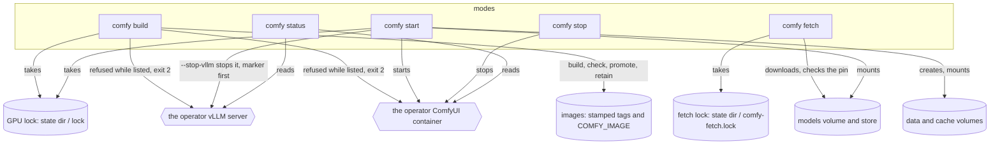

# Module — ComfyUI (the image, the model sets, the five modes)

The operator's own ComfyUI on the R9700, made from this repository: `comfyui/` holds the image recipe, the program that starts ComfyUI inside it, the model download and the pinned model sets, with no machine value in them; `lib/comfy.sh` holds the five modes of `bin/r9700 comfy`. The machine values (image tag, container and volume names, port, folders, ceilings) are the twelve `COMFY_*` fields of `machine.env` (`module_config.md`).

## Purpose

One owner of the card at a time. The operator's vLLM server and the operator's ComfyUI cannot both hold the R9700. No verb stops ComfyUI by itself: every verb that runs under the supervisor refuses (exit 2, naming `bin/r9700 comfy stop`) while `COMFY_CONTAINER` is listed, and `comfy build` refuses beside either owner. `comfy stop` is the operator's own command. The image is built on any PC this toolkit's `machine.env` describes, and the model sets come from the repository with their sha256 pinned, so the hand-made folder is not needed to run ComfyUI.

## The image

The base is `rocm/pytorch:rocm10.1.0_ubuntu24.04_py3.12_pytorch_release_2.13.0` (`COMFY_BASE_IMAGE`): ROCm 10.1 with `torch 2.13.0+rocm10.1.0`, Python 3.12 (ComfyUI recommends 3.13 and accepts 3.12; 3.14 breaks some custom nodes). Under `wslc run --gpus all` the card is `/dev/dxg` plus `/usr/lib/wsl/lib`, there is no `/dev/kfd`, and an image reaches the card only when it carries `librocdxg` for its own ROCm; this base does, and so does the vLLM image. AMD's own `rocm/comfyui` image is not used: its newest tags (2026-05-05) are ROCm 7.2.0 and 7.1.0, list Instinct cards only, and ROCm before 7.13 needs `HSA_ENABLE_DXG_DETECTION=1` plus a host `librocdxg`, which `wslc` does not provide; community RDNA4 images are written for `/dev/kfd`. (Observed by hand 2026-11-07.)

ComfyUI is cloned at `COMFY_REF` (a git tag) and installed from its two requirement files with the base's torch family and ROCm packages as pip constraints (`/opt/rocm-constraints.txt`), so no later pip install can swap torch for a CUDA build. `BASE` and `COMFYUI_REF` are build arguments; both values are validated when the config is loaded (an image reference, a git tag word: no space, no leading `-`).

### The three traps

| Trap | Observation (2026-11-07) | Where the repository keeps the fix |
|---|---|---|
| 1. `PYTORCH_HIP_ALLOC_CONF=expandable_segments:True`, which AMD's RX 9000 guide recommends | under `wslc`/dxg the first GPU allocation fails (`hipErrorInvalidValue` on `torch.zeros(..., device="cuda")`) and ComfyUI then disables flash attention; without it SDPA flash and efficient attention both run on gfx1201 and ComfyUI logs `Using pytorch attention` | `comfyui/Containerfile`: the variable is NOT set, and the comment above its `ENV` block says why. `tests/test_comfy.sh` IM1 fails when a code line of the Containerfile or `entrypoint.sh` names it |
| 2. The Manager defaults to `use_uv = True` | `uv pip list` in a `--system-site-packages` venv lists only the venv, so the Manager reports `PyTorch is not installed` and installs the image's packages into the venv, where they shadow a newer image after a rebuild | `comfyui/entrypoint.sh` sets `use_uv = False` in `/data/user/__manager/config.ini` at every start, in each of three starting states (no file, `use_uv = True`, a `[default]` section without the line); IM3 |
| 3. `PIP_USER=1` to keep node packages in a volume | the same effect through `pip list --user` | a venv with `--system-site-packages` on the data volume (`/data/venv`): torch and ROCm come from the image, what a custom node installs goes into the venv and survives a rebuild. A venv made by another Python version is moved aside to `venv.python-<version>.<UTC stamp>`, never deleted; IM4 |

## The files

| File | What |
|---|---|
| `comfyui/Containerfile` | the recipe; `curl` is in its apt list because `fetch_model.sh` runs in this image |
| `comfyui/entrypoint.sh` | starts ComfyUI with all state in the volumes `/data`, `/models`, `/cache`; extra arguments go to `main.py`; two test knobs, `R9700_TEST_COMFY_ROOT` and `R9700_TEST_ENTRY_DRY` |
| `comfyui/fetch_model.sh` | downloads files into the models volume (and the store), each accepted only when its own sha256 equals the pin; two test knobs, `R9700_TEST_FETCH_STORE` and `R9700_TEST_FETCH_MODELS` |
| `comfyui/models.conf` | the three sets (`sd15`, `zimage`, `wan5b`), one line per file: `<set> <folder> <url> <sha256>` |

`comfy build` and `comfy fetch` place these three scripts (not `models.conf`) in `$WORK_DIR/r9700/comfyui/` with `moe_place`, hash-checked, and use that folder as the build context and as the read-only `/work` mount of the fetch container.

## The flows

**`build [--no-cache]`.** The grammar is checked, then the lock (`comfy_locked build card-free`, holder word `comfy`), the restore from a standing marker, the machine config and the two-owner admission: ComfyUI listed (the owner line) or the operator's server listed (the server line; a standing marker restores the server first and the build is then refused) end the verb with exit 2 before anything is placed or built. Then, in the body: the tag of `COMFY_IMAGE` must not look like a build stamp (exit 2); the placement; the image list (three tries); the build to a STAMPED tag `<repository of COMFY_IMAGE>:<UTC stamp>` (`YYYYMMDDTHHMMSSZ`; never to `COMFY_IMAGE`); the check of THAT tag by a throwaway container on the card (`--gpus all`, `python3`): the check program prints `torch`, `hip`, `device` and `matmul` lines and the image is accepted only when `hip` is not `None`, a device is named and a 1024x1024 fp16 matmul gives a finite sum, not on the exit code alone; and only then `COMFY_IMAGE` is pointed at the stamped tag (the `tag` call). A failed build, a failed check or a refused promotion leaves `COMFY_IMAGE` and the earlier stamped tags as they were; the rejected stamped tag is removed by its exact name, unless the image list cannot be read (the line says so) or the tag is the image `COMFY_IMAGE` already names (kept). A promotion whose `tag` call fails is decided from the image list, not from the call's code (a ceiling can hit after the engine moved the tag): `COMFY_IMAGE` on the stamped image counts as moved (the success lines, the retention); not moved keeps the passed tag, a good image one hand command from being current (see *Stamped tags and rollback*); a list that cannot be read says that whether the tag moved is not known.

**The retention.** After a passed promotion the stamped tags of the repository (a tag that is a build stamp, nothing else: another repository, an untagged row and a tag of another shape are not ours) are sorted by their text (a stamp's text order is its time order, and the engine's `CREATED` column is relative words) and the newest four stay: the current image plus three to roll back to. Older ones are removed one exact tag per call (never an id, a pattern or `-f`), and a tag whose image is the one `COMFY_IMAGE` names is kept (a cached rebuild has the id of an older build; whether the engine's `rmi` of a shared id only untags is not observed, so it is never asked). The retention runs only on a view it can trust: a list that failed three times, or one that does not show the new tag, is a warning line and no removal. A failed removal is a warning line; the next build's retention catches up. The first stamped build leaves the image a hand-made `COMFY_IMAGE` named untagged: that image, and the untagged ones older hand-made builds left, are the operator's to remove by id (the toolkit never prunes the engine's untagged images: other images' parents are among them). Observed 2026-11-07: three builds with the fixed tag `comfyui-r9700:local` left three untagged images of 27.3 GB listed size each (the ROCm base layers are shared, about 2 GB of their own).

**`fetch <set>...`.** The sets are checked before any lock (an unknown set or no set is exit 2 naming the legal sets; a malformed `models.conf` is exit 2 with `<file>:<line>`). Then the fetch lock `<state dir>/comfy-fetch.lock` (`lock_take comfy-fetch comfy-fetch.lock`; never the GPU lock, so a fetch runs beside a series), the machine config, the container list, and the refusal while a container named `<COMFY_CONTAINER>-fetch` is listed (exit 4: a fetch whose host process was killed leaves its container running with the lock released, and a second container would resume the same `.part` beside it; the engine's refusal of a second run of the name is the backstop, never the check). Then the placement, the models volume (made only when missing), and one foreground container without the card: `run --rm --name <COMFY_CONTAINER>-fetch -v <models volume>:/models [-v <COMFY_STORE_WIN>:/store] -v <WORK_DIR_WIN>:/work:ro --entrypoint bash <COMFY_IMAGE> /work/r9700/comfyui/fetch_model.sh <folder> <url> <sha256>...`. The container's exit code becomes the verb's: 0 done, 3 (a source publishes another sha256 than the pin) exit 2, anything else exit 1 (a ceiling says so). The container's name is not under `CONTAINER_PREFIX`, so the cleanup of a run never stops a fetch in progress. `fetch` never restores the operator's server: it holds no GPU lock and needs no card; the next GPU verb restores.

**`start [--stop-vllm] [-- <main.py args>]`, `stop`, `status`.** As `architecture.md` § *ComfyUI (E1.S2)* describes them: `start` holds the toolkit's lock through its readiness wait and reconciles a failed start against the container list; `stop` and `status` take no lock.

## Stamped tags and rollback

Every build is tagged `<repository>:<UTC stamp>`; only a passed check moves `COMFY_IMAGE`. There is no `comfy build --rollback`. A rollback is one command by hand, then a start: `wslc tag <repository>:<older stamp> <COMFY_IMAGE>`, then `bin/r9700 comfy start`. (`bin/r9700 comfy status` prints the image's creation time.) The repository is `COMFY_IMAGE` without its `:<tag>`; the older stamps are the ones `wslc image list` shows.

## `models.conf` and the pinned hash

Each line is one file: `<set> <folder> <url> <sha256>`. The sha256 was read once from the source's `X-Linked-ETag` on 2026-11-07 and is checked by every download; a pin is changed only by a reviewed commit. `fetch_model.sh` is a pre-flight cross-check and a download: it reads the published hash with a `HEAD` request and refuses (exit 3, before any download) a source that publishes another hash than the pin; a source that publishes none is accepted when the download's own sha256 equals the pin; bytes that do not match the pin are removed (a kept wrong `.part` would be resumed from its end by the next fetch and never match). The store (`COMFY_STORE_WIN`) is written first when it is mounted; a right file in the models volume fills a store that lacks it; a partial download resumes (a source that ignores `Range`, curl 33, has the `.part` removed and the file downloaded once from zero); a `.part` that is already whole is moved into place without a request. The urls name the current repositories (`stable-diffusion-1.5`, `Z-Image-Turbo`, `Wan-2.2`, `Wan-2.1`); the names the sets were first asked under answer 307 to them. A url is `https://` with no quote, backslash, backtick, bracket, brace or blank, and the file name (the last part of the url path before any `?` or `#`) is letters, digits, `.`, `_`, `-` starting with a letter or digit (never `.`, `..` or a leading `-`); `comfy_models_load` and `fetch_model.sh` apply the same two rules and both curl calls pass `-g`. `comfy_models_load` refuses a malformed line with its place (`r9700: comfy: <file>:<line>: <problem>`); `R9700_COMFY_MODELS_CONF` names another file for a test.

## Growth

| Surface | Size | Who retires it | Interrupted |
|---|---|---|---|
| the volume `COMFY_MODELS_VOLUME` | about 2.1 GB (`sd15`), 20.7 GB (`zimage`), 18.1 GB (`wan5b`): about 41 GB with the three sets | the operator, by hand (`wslc volume remove`); the toolkit never removes a volume (a download costs hours) | a killed fetch leaves `<name>.part`; the next fetch of the set resumes it, and a wrong one is removed when it fails its pin; a fetch whose host process was killed while its container lives on is not resumed beside it: the next fetch refuses while `<COMFY_CONTAINER>-fetch` is listed |
| the store `COMFY_STORE_WIN` | the same, about 41 GB | the operator | as above |
| the volume `COMFY_DATA_VOLUME` | about 0 until a custom node installs packages; one `venv.python-<version>.<stamp>` folder per change of the image's Python | the operator, by hand | |
| the volume `COMFY_CACHE_VOLUME` | at most 2 GB projected, not measured yet | the operator, by hand (ComfyUI rebuilds the caches) | |
| the placed copies `$WORK_DIR/r9700/comfyui/` | three files, about 9 KB | rewritten when the repository's file changes (`moe_place`) | a `.part` left by a kill is replaced by the next placement |
| the failed-start log tails in the state folder | about 20 KB per failed start (200 lines) | `comfy_tails_prune` keeps the newest ten | |
| the images of `COMFY_IMAGE`'s repository, one stamped tag per passed build | 27.3 GB each as listed, but the ROCm base layers are shared, so a kept build costs its own layers, about 2 GB: four kept about 8 GB beyond the base | the build itself, after the new image passed its check and `COMFY_IMAGE` names it: the newest four stamped tags stay, older ones are removed by their exact tag; a rejected build's stamped tag is removed at once; the untagged leftovers of hand-made builds, and the image the first stamped build untags, are the operator's to remove by id | a build killed, or cut by its ceiling, may leave its stamped tag (the engine can finish after the client is gone): never `COMFY_IMAGE`, counted by the next passed build's retention like any other |
| the fetch lock `<state dir>/comfy-fetch.lock` | one file, one holder line (about 50 bytes) | kept, like the GPU lock file; each taker rewrites its line | a SIGKILL releases the flock with the process (descriptor 9 is never inherited by a child); the stale holder line is rewritten by the next taker |

## What is not proven

- **A stamped tag is not proof of a passed check.** A build ended by its ceiling, or a verb killed during the build, can leave an image under a stamp tag that was never checked: the engine can finish the build after the client is gone. The retention then counts that tag like any other (it is shaped like a stamp), and the rollback of this document (`wslc tag <repository>:<older stamp> <COMFY_IMAGE>`) cannot tell it from a passed one. Until a follow-up records the stamps that passed their check, pick the stamp to roll back to by its creation time and `comfy status`, and check the image by hand.
- **The outputs of `tag` and `rmi` are the stub's, not observed** (see `module_tests.md`): the acceptance run 1 records the first, the fifth passed build the second.

## Observed on the R9700 while rendering, 2026-11-07/08

Two facts from hand runs of the Wan 2.2 TI2V 5B model (the `wan5b` set) in this image. They concern the workflow, not the image; each is one run or one sweep, not a speed claim.

1. **The VAE decode of a long video must be tiled.** Image-to-video at 1280x704, 121 frames: an UNTILED VAE decode stalled for more than 10 minutes (the card's memory and the pinned staging memory filled). `VAEDecodeTiled` (tile 512, overlap 64, temporal 32, temporal overlap 8) decoded the same latent in about 100 s. A sweep with the sampler's result held in ComfyUI's cache found the settings 512 / 32 / 64 / 4 (tile, temporal, overlap, temporal overlap) about 30 % faster (70 s), while LARGER tiles were 2 to 6 times slower (768: 320 s, 1280: 626 s).
2. **20 steps leave a fine diagonal hatching ("a mesh") in the latent; 50 steps remove it.** The same model at 20 `uni_pc` steps shows it in a lossless PNG of a decoded frame. It is unchanged with `--fp32-vae`, with other tile sizes and with `--bf16-unet`, and the start keyframe is clean, so it comes from the sampling, not from the decode or the precision. 50 steps (the model's official setting) removes it. Measure: a 2x2 checkerboard energy over 13 frames: 3.45 at 20 steps, 1.61 at 50 steps, 2.53 for the keyframe. The FastWan step-distill LoRA (3 steps, `lcm`, cfg 1, shift 8) gives 2.32 and about 122 to 143 s per clip, against 340 s for the plain run. What these runs do not settle: one prompt and one seed, one measure of the hatching, and the images were judged by the measure and by eye.

## Acceptance on the R9700 (E1)

Not run yet. The operator's session runs the three runs after the merge and fills this section: the prediction is written here BEFORE the first command, then each command with its output in a fenced block, the commit it ran at, the date, and what the record does not settle. It is not an `ACCEPTANCE_*.md` file: a second file of that name would also pull `POST_DEPLOY.md` through `tests/test_docs.sh`.

1. `bin/r9700 comfy build`. Prediction: the check prints `device AMD Radeon AI PRO R9700` and `matmul ok`; the build takes less than `COMFY_BUILD_MAX_S`; `COMFY_IMAGE` then names the stamped tag, and the image it named before (the hand-made build) is left untagged, the one untagged image this change adds, removed by the operator by its id. To record: the wall time, the check's four lines, the raw `wslc image list` before and after (it checks the parse of `wslc_image_list` and the size the growth row carries), and the raw output of the promotion's `tag`. A real `rmi` runs first at the fifth passed build; its output is added to this section then (until then the stub's text stands, as `module_tests.md` says).
2. `bin/r9700 comfy fetch zimage wan5b` with `COMFY_STORE_WIN` set. Prediction: every file ends `fetch: done ... sha256 <the pin>`, the store first. To record: the lines, the wall time, the raw output of `wslc volume list` once (it checks the parse of `wslc_volume_list`; a different shape is a fix and a deviation).
3. `bin/r9700 comfy start --stop-vllm`, then by hand in the Windows browser on `127.0.0.1:<COMFY_PORT>` ComfyUI's own Z-Image Turbo workflow at 1024x1024. Prediction: the start prints the R9700 device line, the log shows `Using pytorch attention`, the image is correct. While it runs, the one owner of the card on the real machine: `bin/r9700 step --model <a model file> probe -- true` exits 2 naming `bin/r9700 comfy stop`, and `bin/r9700 comfy status` afterwards still lists `COMFY_CONTAINER` (nothing was stopped). Then `bin/r9700 comfy stop`. To record: the lines, the image's time, the log line, and that the operator looked at the image.

The output shapes of `wslc volume list`, `wslc volume create`, `wslc inspect` and `wslc image list` were observed by hand on 2026-11-07; the output of `tag` and `rmi` was not. The hand-made folder is not used for any of the three runs.
