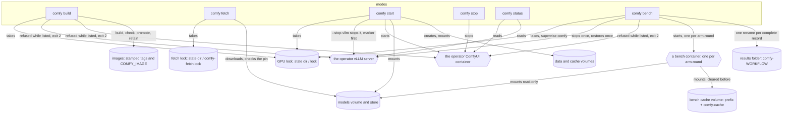

# Module — ComfyUI (the image, the model sets, the bench, the six modes)

The operator's own ComfyUI on the R9700, made from this repository: `comfyui/` holds the image recipe, the program that starts ComfyUI inside it, the model download and the pinned model sets, and, for the bench, the program that times a workflow and the two tables of the arms, with no machine value in them; `lib/comfy.sh` holds five modes of `bin/r9700 comfy` (`start`, `stop`, `status`, `build`, `fetch`) and `lib/comfy_bench_verb.sh` the sixth, `bench`. The machine values (image tag, container and volume names, port, folders, ceilings) are the twelve `COMFY_*` fields of `machine.env` (`module_config.md`).

## Purpose

One owner of the card at a time. The operator's vLLM server and the operator's ComfyUI cannot both hold the R9700. No verb stops ComfyUI by itself: every verb that runs under the supervisor refuses (exit 2, naming `bin/r9700 comfy stop`) while `COMFY_CONTAINER` is listed, and `comfy build` refuses beside either owner. `comfy stop` is the operator's own command. The image is built on any PC this toolkit's `machine.env` describes, and the model sets come from the repository with their sha256 pinned, so the hand-made folder is not needed to run ComfyUI.

`comfy bench` measures ComfyUI arms (a server flag, an environment word, or how the model is loaded) against a base arm on one workflow, as ONE supervised step: one lock, the operator's vLLM server stopped once and restored once, every arm-round in a fresh container of its own, every record made only when complete, and `bin/r9700 verdict <folder>` giving the ship test over the records. Section *The bench* below.

## The image

The base is `rocm/pytorch:rocm10.1.0_ubuntu24.04_py3.12_pytorch_release_2.13.0` (`COMFY_BASE_IMAGE`): ROCm 10.1 with `torch 2.13.0+rocm10.1.0`, Python 3.12 (ComfyUI recommends 3.13 and accepts 3.12; 3.14 breaks some custom nodes). Under `wslc run --gpus all` the card is `/dev/dxg` plus `/usr/lib/wsl/lib`, there is no `/dev/kfd`, and an image reaches the card only when it carries `librocdxg` for its own ROCm; this base does, and so does the vLLM image. AMD's own `rocm/comfyui` image is not used: its newest tags (2026-05-05) are ROCm 7.2.0 and 7.1.0, list Instinct cards only, and ROCm before 7.13 needs `HSA_ENABLE_DXG_DETECTION=1` plus a host `librocdxg`, which `wslc` does not provide; community RDNA4 images are written for `/dev/kfd`. (Observed by hand 2026-11-07.)

ComfyUI is cloned at `COMFY_REF` (a git tag) and installed from its two requirement files with the base's torch family and ROCm packages as pip constraints (`/opt/rocm-constraints.txt`), so no later pip install can swap torch for a CUDA build. `BASE` and `COMFYUI_REF` are build arguments; both values are validated when the config is loaded (an image reference, a git tag word: no space, no leading `-`).

### The three traps

| Trap | Observation (2026-11-07) | Where the repository keeps the fix |
|---|---|---|
| 1. `PYTORCH_HIP_ALLOC_CONF=expandable_segments:True`, which AMD's RX 9000 guide recommends | under `wslc`/dxg the first GPU allocation fails (`hipErrorInvalidValue` on `torch.zeros(..., device="cuda")`) and ComfyUI then disables flash attention; without it SDPA flash and efficient attention both run on gfx1201 and ComfyUI logs `Using pytorch attention` | `comfyui/Containerfile`: the variable is NOT set, and the comment above its `ENV` block says why. `tests/test_comfy.sh` IM1 fails when a code line of the Containerfile or `entrypoint.sh` names it |
| 2. The Manager defaults to `use_uv = True` | `uv pip list` in a `--system-site-packages` venv lists only the venv, so the Manager reports `PyTorch is not installed` and installs the image's packages into the venv, where they shadow a newer image after a rebuild | `comfyui/entrypoint.sh` sets `use_uv = False` in `/data/user/__manager/config.ini` at every start, in each of three starting states (no file, `use_uv = True`, a `[default]` section without the line); IM3 |
| 3. `PIP_USER=1` to keep node packages in a volume | the same effect through `pip list --user` | a venv with `--system-site-packages` on the data volume (`/data/venv`): torch and ROCm come from the image, what a custom node installs goes into the venv and survives a rebuild. A venv made by another Python version is moved aside to `venv.python-<version>.<UTC stamp>`, never deleted; IM4 |

## The files

| File | What |
|---|---|
| `comfyui/Containerfile` | the recipe; `curl` is in its apt list because `fetch_model.sh` runs in this image |
| `comfyui/entrypoint.sh` | starts ComfyUI with all state in the volumes `/data`, `/models`, `/cache`; extra arguments go to `main.py`; two test knobs, `R9700_TEST_COMFY_ROOT` and `R9700_TEST_ENTRY_DRY` |
| `comfyui/fetch_model.sh` | downloads files into the models volume (and the store), each accepted only when its own sha256 equals the pin; two test knobs, `R9700_TEST_FETCH_STORE` and `R9700_TEST_FETCH_MODELS` |
| `comfyui/models.conf` | the three sets (`sd15`, `zimage`, `wan5b`), one line per file: `<set> <folder> <url> <sha256>`; `wan5b` also holds the FastWan step-distillation LoRA (`loras` folder), the file the `wan5b` workload loads |
| `comfyui/bench.py` | the program of the bench: inside the container it queues ONE workflow on the ComfyUI server, times it and checks its output; on the host its pure commands (`workflows`, `metrics`, `words`, `models`, `constants`, `graph`) run with the standard library alone. `WORKFLOWS`, `SEEDS`, `CEILINGS` and `METRICS` in it are the only place a seed, a ceiling or a tile value is typed |
| `comfyui/arms.conf` | the six arms (`base`, `fp16acc`, `fp8wmm`, `tunableop`, `miopen`, `compile`) in the four-field grammar of `config/arms.conf`: `name \| ComfyUI arguments \| environment \| mounts` |
| `comfyui/arm_evidence.conf` | one row per arm: `arm \| activation \| inertness`, the checks that prove the arm acted in its own arm-round, and the ones that prove it could not act on the workflow |

`comfy build` and `comfy fetch` place these three scripts (not `models.conf`) in `$WORK_DIR/r9700/comfyui/` with `moe_place`, hash-checked, and use that folder as the build context and as the read-only `/work` mount of the fetch container. `comfy bench` places `bench.py` there the same way before anything is stopped.

## The flows

**`build [--no-cache]`.** The grammar is checked, then the lock (`comfy_locked build card-free`, holder word `comfy`), the restore from a standing marker, the machine config and the two-owner admission: ComfyUI listed (the owner line) or the operator's server listed (the server line; a standing marker restores the server first and the build is then refused) end the verb with exit 2 before anything is placed or built. Then, in the body: the tag of `COMFY_IMAGE` must not look like a build stamp (exit 2); the placement; the image list (three tries); the build to a STAMPED tag `<repository of COMFY_IMAGE>:<UTC stamp>` (`YYYYMMDDTHHMMSSZ`; never to `COMFY_IMAGE`); the check of THAT tag by a throwaway container on the card (`--gpus all`, `python3`): the check program prints `torch`, `hip`, `device` and `matmul` lines and the image is accepted only when `hip` is not `None`, a device is named and a 1024x1024 fp16 matmul gives a finite sum, not on the exit code alone; and only then `COMFY_IMAGE` is pointed at the stamped tag (the `tag` call). A failed build, a failed check or a refused promotion leaves `COMFY_IMAGE` and the earlier stamped tags as they were; the rejected stamped tag is removed by its exact name, unless the image list cannot be read (the line says so) or the tag is the image `COMFY_IMAGE` already names (kept). A promotion whose `tag` call fails is decided from the image list, not from the call's code (a ceiling can hit after the engine moved the tag): `COMFY_IMAGE` on the stamped image counts as moved (the success lines, the retention); not moved keeps the passed tag, a good image one hand command from being current (see *Stamped tags and rollback*); a list that cannot be read says that whether the tag moved is not known.

**The retention.** After a passed promotion the stamped tags of the repository (a tag that is a build stamp, nothing else: another repository, an untagged row and a tag of another shape are not ours) are sorted by their text (a stamp's text order is its time order, and the engine's `CREATED` column is relative words) and the newest four stay: the current image plus three to roll back to. Older ones are removed one exact tag per call (never an id, a pattern or `-f`), and a tag whose image is the one `COMFY_IMAGE` names is kept (a cached rebuild has the id of an older build; whether the engine's `rmi` of a shared id only untags is not observed, so it is never asked). The retention runs only on a view it can trust: a list that failed three times, or one that does not show the new tag, is a warning line and no removal. A failed removal is a warning line; the next build's retention catches up. The first stamped build leaves the image a hand-made `COMFY_IMAGE` named untagged: that image, and the untagged ones older hand-made builds left, are the operator's to remove by id (the toolkit never prunes the engine's untagged images: other images' parents are among them). Observed 2026-11-07: three builds with the fixed tag `comfyui-r9700:local` left three untagged images of 27.3 GB listed size each (the ROCm base layers are shared, about 2 GB of their own).

**`fetch <set>...`.** The sets are checked before any lock (an unknown set or no set is exit 2 naming the legal sets; a malformed `models.conf` is exit 2 with `<file>:<line>`). Then the fetch lock `<state dir>/comfy-fetch.lock` (`lock_take comfy-fetch comfy-fetch.lock`; never the GPU lock, so a fetch runs beside a series), the machine config, the container list, and the refusal while a container named `<COMFY_CONTAINER>-fetch` is listed (exit 4: a fetch whose host process was killed leaves its container running with the lock released, and a second container would resume the same `.part` beside it; the engine's refusal of a second run of the name is the backstop, never the check). Then the placement, the models volume (made only when missing), and one foreground container without the card: `run --rm --name <COMFY_CONTAINER>-fetch -v <models volume>:/models [-v <COMFY_STORE_WIN>:/store] -v <WORK_DIR_WIN>:/work:ro --entrypoint bash <COMFY_IMAGE> /work/r9700/comfyui/fetch_model.sh <folder> <url> <sha256>...`. The container's exit code becomes the verb's: 0 done, 3 (a source publishes another sha256 than the pin) exit 2, anything else exit 1 (a ceiling says so). The container's name is not under `CONTAINER_PREFIX`, so the cleanup of a run never stops a fetch in progress. `fetch` never restores the operator's server: it holds no GPU lock and needs no card; the next GPU verb restores.

**`start [--stop-vllm] [-- <main.py args>]`, `stop`, `status`.** As `architecture.md` § *ComfyUI (E1.S2)* describes them: `start` holds the toolkit's lock through its readiness wait and reconciles a failed start against the container list; `stop` and `status` take no lock.

**`bench <workflow> <arm>... [--rounds N] [--out <name>] [--dry-run]`.** The grammar is checked before the lock (a workflow of `bench.py workflows`, at least one arm, each arm a name of lower-case letters and digits and given once, `--rounds` 1 to 20, default 3, `--out` a folder name, default `comfy-<workflow>`; the arm `base` must be one of the arms). Then `supervise comfy …`: the lock (holder word `comfy`, so a held lock is exit 4 first), the restore from a standing marker, the machine config alone (no model file), the check of the two tables (every arm of the command line is in `arms.conf` and has an evidence row), the owner check of the card (the operator's ComfyUI listed is exit 2, the one owner line, nothing stopped), the deadline and the run folder. In the body: `bench.py` is placed; with `--dry-run` the identity is only compared and the first arm-round's commands are printed (`dry-run: …`; the dry run, like the series' one, runs one read-only listing container without the card); otherwise the identity of the experiment is built or compared and merged (another experiment is refused here, before anything is stopped), the arm-rounds with no final record are counted (none left: `comfy: bench: <n> of <n> arm-rounds recorded, nothing to do`, nothing stopped), and the worker `lib/comfy_bench.sh` runs as ONE `step_run`: the operator's server is stopped once at its admission and restored once at the end, however many arm-rounds it runs. The last line is `comfy: bench: <n> of <total> arm-rounds recorded; read them with bin/r9700 verdict <folder>`. A signal ends the container and restores the server (exit 143, 130 or 129); a rejected arm-round is retried up to `MAX_FAILED_TRIES` times and then the step fails (exit 7).

## Stamped tags and rollback

Every build is tagged `<repository>:<UTC stamp>`; only a passed check moves `COMFY_IMAGE`. There is no `comfy build --rollback`. A rollback is one command by hand, then a start: `wslc tag <repository>:<older stamp> <COMFY_IMAGE>`, then `bin/r9700 comfy start`. (`bin/r9700 comfy status` prints the image's creation time.) The repository is `COMFY_IMAGE` without its `:<tag>`; the older stamps are the ones `wslc image list` shows.

## `models.conf` and the pinned hash

Each line is one file: `<set> <folder> <url> <sha256>`. The sha256 was read once from the source's `X-Linked-ETag` on 2026-11-07 and is checked by every download; a pin is changed only by a reviewed commit. `fetch_model.sh` is a pre-flight cross-check and a download: it reads the published hash with a `HEAD` request and refuses (exit 3, before any download) a source that publishes another hash than the pin; a source that publishes none is accepted when the download's own sha256 equals the pin; bytes that do not match the pin are removed (a kept wrong `.part` would be resumed from its end by the next fetch and never match). The store (`COMFY_STORE_WIN`) is written first when it is mounted; a right file in the models volume fills a store that lacks it; a partial download resumes (a source that ignores `Range`, curl 33, has the `.part` removed and the file downloaded once from zero); a `.part` that is already whole is moved into place without a request. The urls name the current repositories (`stable-diffusion-1.5`, `Z-Image-Turbo`, `Wan-2.2`, `Wan-2.1`); the names the sets were first asked under answer 307 to them. A url is `https://` with no quote, backslash, backtick, bracket, brace or blank, and the file name (the last part of the url path before any `?` or `#`) is letters, digits, `.`, `_`, `-` starting with a letter or digit (never `.`, `..` or a leading `-`); `comfy_models_load` and `fetch_model.sh` apply the same two rules and both curl calls pass `-g`. `comfy_models_load` refuses a malformed line with its place (`r9700: comfy: <file>:<line>: <problem>`); `R9700_COMFY_MODELS_CONF` names another file for a test.

## The bench

`bin/r9700 comfy bench <workflow> <arm>... [--rounds N] [--out <name>] [--dry-run]` (the flow is in *The flows*; the supervisor half is `lib/comfy_bench_verb.sh`, the arm-round is the worker `lib/comfy_bench.sh`, which `step_run` starts, and the program inside the container is `comfyui/bench.py`). Every invocation lists the arm `base`, first: it is the reference of every verdict, the identity of an experiment names it (a command without it is refused by the grammar, before the lock: `the arm base must be one of the arms`; the fingerprint refuses it too, as the second line of defence), and the drift of every other arm in round 1 is taken against the base's round 1, which must already be recorded (listed after another arm, `base` leaves that drift `unavailable (no base-1 record)`).

**The arms** (`comfyui/arms.conf`). An arm changes the server's flags or environment, or how `bench.py` loads or wraps the model; it never changes the workflow's sampling or decode constants (those are the workload's identity). Each row differs from `base` in one change:

| Arm | Change | Activation evidence (`comfyui/arm_evidence.conf`) | Inertness evidence |
|---|---|---|---|
| `base` | nothing | `Using pytorch attention` in the server log | none: the reference is never inert |
| `fp16acc` | `--fast fp16_accumulation` | `Enabled fp16 accumulation.` in the log | the model's weight dtype line and the VAE's dtype line both say `torch.bfloat16` |
| `fp8wmm` | `--fast fp8_matrix_mult` and `COMFY_BENCH_WEIGHT_DTYPE=fp8_e4m3fn` (the loader's weight dtype) | the model's dtype line says `torch.float8_e4m3fn` and the server's argv holds `fp8_matrix_mult` | none |
| `tunableop` | `PYTORCH_TUNABLEOP_ENABLED=1`, its results file in the bench cache, and the bounds of 10 ms and 10 iterations per shape | the copied results file has a `Validator` line and at least one result row | none |
| `miopen` | `COMFYUI_ENABLE_MIOPEN=1`, `MIOPEN_FIND_MODE=FAST`, `MIOPEN_LOG_LEVEL=5` (without a log level MIOpen prints no find line) | `cudnn.enabled = False` is NOT in the log and MIOpen's find lines are in the cold run's cut of it | none |
| `compile` | `COMFY_BENCH_COMPILE=1` (a `TorchCompileModel` node after the loader), `TORCHINDUCTOR_CACHE_DIR=/cache/inductor`, `TORCH_LOGS=recompiles` | the node is in every measured run's node list (executed, or reused from ComfyUI's execution cache: the loaders and the compile node are cached in a measured run, so `executing` never names them) and the inductor cache holds files after the cold run | none |

An arm may set only the two `COMFY_BENCH_*` words of `bench.py` (`bench.py words`); a memory or cache mode of ComfyUI, `PYTORCH_HIP_ALLOC_CONF` (trap 1) and a mount are refused by `comfy_bench_check`, a row whose activation evidence is the argv alone is refused (a flag that was passed is not proof it acted), and so is a row whose activation field is `-` (every arm, `base` included, names the evidence that it took effect).

**The workloads** (`bench.py`; every input is pinned in its one table, and the table is part of the identity). `sd15` is the 20-step checkpoint workflow. `zimage` is Z-Image Turbo bf16 at 1024x1024, 8 steps, `res_multistep`, `simple`, cfg 1, shift 3, `ModelSamplingAuraFlow`, an empty negative prompt (inert at cfg 1). `wan5b` is Wan 2.2 TI2V 5B text-to-video at 1280x704, 121 frames, 24 fps, with the FastWan step-distillation LoRA (strength 1.0, pinned in `models.conf`): 3 steps, `lcm`, `simple`, cfg 1, shift 8, an empty negative prompt, and the tiled decode with the named fields `tile_size 512, overlap 64, temporal_size 32, temporal_overlap 8`. The video workload is the distilled one because the plain 20-step output carries a diagonal hatching and the 50-step output that removes it takes about 700 s per clip (the observations above); the distilled clip took about 122 to 143 s by hand. The faster tiled decode (`tile_size 512, overlap 32, temporal_size 64, temporal_overlap 4`) is a different workload, not an arm. Per workload there are two ceilings, `run_max_s` for a measured run and `cold_max_s` for the cold run (`zimage` 300 and 1800 s, `wan5b` 600 and 2700 s, `sd15` 120 and 600 s), and both are in the identity.

**One arm-round** (the worker's header holds the full contract). The gate (the disk log, a quiet PC, the time that is left against the deadline) and the identity are checked before EVERY arm-round, because one step can restart the worker for hours. The bench cache volume `<CONTAINER_PREFIX>comfy-cache` is made when it is missing and cleared before the arm-round by a prefixed throwaway container that prints the sizes (`cache.txt`, `before clear`) and empties the MIOpen, Triton, TunableOp and inductor folders; a clear that fails refuses the arm-round (a stale cache would be measured). Then ONE fresh prefixed container: the card, `--tmpfs /data:exec,size=8g` (an empty `/data` in memory, with `exec` because the entrypoint runs Python from a venv under it), the models volume read-only, the bench cache, the work folder, the arm's environment, ComfyUI's default memory mode and the arm's arguments. It must answer on `/system_stats`, and the worker waits (probes 10 s apart, at most 300 s) until `vram_free` is at least 90 % of `vram_total`, with one progress line every 30 s (`comfy: bench: <tag>: waiting for the card: vram_free X of Y (Ns)`); both readings are recorded, and a card that does not free in time is rejected as `UNSTARTED` with a reason that names the remedy (another container may hold the card: the engine's container list shows which; the operator's ComfyUI: `bin/r9700 comfy stop`). Then one untimed COLD run (model load, kernel compile, TunableOp or MIOpen search; seed 4242, bounded by `cold_max_s`: past it the arm-round is rejected as `COLD_TIMEOUT` with the time it reached, and the arm is *not measurable within the cold-run ceiling*, never "slower") and three measured runs (seeds 1, 2, 3, the same for every arm, each bounded by `run_max_s`). A run says `run <cold|n> started` on stderr (the worker reads only the lines of the grammar, so progress never enters `bench.txt`) and is queued over HTTP and timed over the websocket; a websocket that sends nothing for half of the run's ceiling is a server that is not working on the run, and the run fails as `HANG` before the ceiling: `total_s` is the time from the POST to the history entry, `sampler_s` and `vae_s` are the nodes' own times. The cold run prints nothing but its total; a measured run prints exactly the three lines of the verdict grammar, `<arm>-<round> <workflow> r=<n> <metric>: <value>`, and only after its output and its cache check passed. An `execution_error`, a refused prompt, a sampler that did not execute (reused from ComfyUI's cache), a wrong size, a constant image and a video of another frame count (`ffprobe -count_frames`) each fail the run at once, and every ceiling ends the container and sees it gone before anything else happens.

After the runs: the log is saved whole (`server.log`) and cut per run (`runs/<k>.log`); each measured run is flagged with the model loads and unloads and the recompiles its cut shows (`flags.txt` and `FLAGS_RUN_<k>=load=<n>,recompile=<m>` in `record.env`, never a line of `bench.txt`, which holds the block only); the drift is computed in the container against the base's ROUND 1 output of the same seed (mean absolute difference and PSNR, `drift.txt`; `unavailable (<why>)` when that output is missing; recorded, never gating; the base's own rounds 2 and 3 are compared with its round 1 the same way, which is the base against itself); the container gets a CLEAN stop (SIGINT to the server, so that TunableOp writes its file; `STOP=clean`, or `STOP=forced` when it stayed) and a report container copies the cache sizes and the TunableOp files into the record; then the evidence is read from the record's own files (a log file the record lacks fails the check with its own one-line reason, never a pass). A missing ACTIVATION check rejects the arm-round (`EVIDENCE: activation <check>: …`); when every INERTNESS check is present the record says `INERT=yes` and keeps the matched lines (`INERT_EVIDENCE`, `evidence.txt`). Only then is the part renamed ONCE, `rounds/<arm>-<round>.part-<run id>/` to `rounds/<arm>-<round>/`. A rejected attempt is moved to `rejected/<arm>-<round>-<UTC stamp>/` with a `reason` file; nothing is deleted.

**The order** is balanced: odd rounds run the arms as given, even rounds in reverse.

**The record.** `<RESULTS_DIR>/<name>/` holds `fingerprint.json` (the identity), `models_listing.txt` (the models the throwaway container found, with the time), `rounds/<arm>-<round>/` (`bench.txt`, `record.env` with the identity of the arm-round, the `vram_free` and `vram_total` readings (the first, and the one that passed the free-card wait), the flags, `STOP`, `INERT` and `INERT_EVIDENCE`, `evidence.txt`, `drift.txt`, `flags.txt`, `cache.txt`, `server.log`, `runs/`, `outputs/`, and the TunableOp file when there is one) and `rejected/`. Nothing in it is deleted by the toolkit.

**The identity and the resume.** `fingerprint.json` is a version-1 document of kind `comfy`: the image reference and id, `COMFY_REF`, every arm's arguments, environment and mounts, the workflow's constants (the seeds, the ceilings, the named tile fields, the LoRA's strength), the pinned sha256 of every model file the workflow loads, the hashes of `bench.py`, of the worker's modules and of the two tables, `base` and `rounds`. The same command again continues the same experiment from the first missing arm-round in the balanced order (a part a killed worker or a host crash left is moved to `rejected/` as `INTERRUPTED: <part> was left by run <id> (its status: …)` at the next worker start, and the next invocation restores the operator's server from the marker first); more rounds and a new arm are extensions that run only what is new; another image, ComfyUI ref, workload constant, arm, model pin or `bench.py` is refused with `fingerprint differs: <path>: <old> -> <new>` before anything is stopped, and again before every arm-round.

**The verdict over a bench folder.** `bin/r9700 verdict <folder>` reads `kind` in the folder's `fingerprint.json`: `comfy` gets the comfy ship test, anything else (a series, a missing file, a file whose digest does not match) goes to the series verdict exactly as before. It prints `comfy bench <folder>: workflow <w>, base <b>, <n> rounds, fingerprint <12 hex>`, a `note:` line for a one-round bench (`1 round, 3 values per arm; the ship test of a series uses 3 rounds`), one `note: <arm> inert on <workflow> (<evidence>)` line for every arm whose round-1 record says `INERT=yes`, the `invoking:` line of `lib/verdict.py comfy --workflow <w> --metrics "total_s sampler_s vae_s" --decide total_s --direction lower …` (lower, because every metric of a bench is seconds), and its lines. The deciding metric is `total_s`; the others are printed as information. For each arm: `PASS` when its median over every run of every round is below the base's by more than the base's spread (max minus min over ALL the base's values, never over round medians), `FAIL` when it is above by more than the spread, `NOT DECIDED (inside the base spread)` when it is inside (never FAIL), `INCOMPLETE` (exit 1) when an arm-round of the arm or of the base is missing. `--base <arm>` judges the base against that arm, `--json <file>` writes the same lines as JSON, and `--no-quality` is refused: a bench has no quality gate, and its drift numbers are in each record. Three rounds are the least the ship test reads as a provisional claim, and only for that workflow, under that image and those pins; a result inside the spread is not "no difference".

## Growth

| Surface | Size | Who retires it | Interrupted |
|---|---|---|---|
| the volume `COMFY_MODELS_VOLUME` | about 2.1 GB (`sd15`), 20.7 GB (`zimage`), 18.8 GB (`wan5b`, the FastWan LoRA's 0.66 GB included): about 42 GB with the three sets | the operator, by hand (`wslc volume remove`); the toolkit never removes a volume (a download costs hours) | a killed fetch leaves `<name>.part`; the next fetch of the set resumes it, and a wrong one is removed when it fails its pin; a fetch whose host process was killed while its container lives on is not resumed beside it: the next fetch refuses while `<COMFY_CONTAINER>-fetch` is listed |
| the store `COMFY_STORE_WIN` | the same, about 41 GB | the operator | as above |
| the volume `COMFY_DATA_VOLUME` | about 0 until a custom node installs packages; one `venv.python-<version>.<stamp>` folder per change of the image's Python | the operator, by hand | |
| the volume `COMFY_CACHE_VOLUME` | at most 2 GB projected, not measured yet | the operator, by hand (ComfyUI rebuilds the caches) | |
| the placed copies `$WORK_DIR/r9700/comfyui/` | three files, about 9 KB | rewritten when the repository's file changes (`moe_place`) | a `.part` left by a kill is replaced by the next placement |
| the failed-start log tails in the state folder | about 20 KB per failed start (200 lines) | `comfy_tails_prune` keeps the newest ten | |
| the images of `COMFY_IMAGE`'s repository, one stamped tag per passed build | 27.3 GB each as listed, but the ROCm base layers are shared, so a kept build costs its own layers, about 2 GB: four kept about 8 GB beyond the base | the build itself, after the new image passed its check and `COMFY_IMAGE` names it: the newest four stamped tags stay, older ones are removed by their exact tag; a rejected build's stamped tag is removed at once; the untagged leftovers of hand-made builds, and the image the first stamped build untags, are the operator's to remove by id | a build killed, or cut by its ceiling, may leave its stamped tag (the engine can finish after the client is gone): never `COMFY_IMAGE`, counted by the next passed build's retention like any other |
| the bench's results folder `<RESULTS_DIR>/comfy-<workflow>/` (E2) | per arm-round: `bench.txt` about 2 KB, four run JSONs about 20 KB, `server.log` about 100 KB, the outputs (`zimage` 4 images of about 1.5 MB, `wan5b` 4 videos of about 5 MB): about 5 MB (`zimage`) and 15 MB (`wan5b`) projected, not measured; a 6-arm, 3-round series about 95 MB (`zimage`) and 270 MB (`wan5b`) | nobody: collected data, kept forever; the toolkit deletes nothing under `RESULTS_DIR` | a part left by a kill or a host crash is moved to `rejected/` as `INTERRUPTED` at the next worker start; each rejected attempt adds up to one arm-round, at most `MAX_FAILED_TRIES` per arm-round per invocation |
| the bench cache volume `<CONTAINER_PREFIX>comfy-cache` (E2) | one arm-round's MIOpen, Triton, TunableOp and inductor caches, at most 2 GB projected, not measured; the clear prints the sizes (`cache.txt`) | its content: the worker, cleared before every arm-round; the volume itself: the operator, by hand (the toolkit never removes a volume) | a killed arm-round leaves its caches until the next arm-round's clear |
| the bench container's `/data` (`--tmpfs /data:exec,size=8g`) | the venv the entrypoint makes at each start and ComfyUI's temporary files, in memory, at most 8 GB by its own size option; not measured | gone with the container (`--rm`) | every ceiling and the cleanup stop the prefixed container |
| the exchange folder `$WORK_DIR/r9700/comfyui/bench/<folder name>/` (E2) | one arm-round's outputs and the base's round-1 references: at most 20 MB (`zimage`), 35 MB (`wan5b`) projected | the worker, once the outputs are in the record; the next worker start removes what a kill left | a kill leaves it until the next worker start |
| the placed `bench.py` under `$WORK_DIR/r9700/comfyui/` (E2) | one file, about 25 KB | rewritten when the repository's file changes (`moe_place`) | a `.part` left by a kill is replaced by the next placement |
| the fetch lock `<state dir>/comfy-fetch.lock` | one file, one holder line (about 50 bytes) | kept, like the GPU lock file; each taker rewrites its line | a SIGKILL releases the flock with the process (descriptor 9 is never inherited by a child); the stale holder line is rewritten by the next taker |

## What is not proven

- **A stamped tag is not proof of a passed check.** A build ended by its ceiling, or a verb killed during the build, can leave an image under a stamp tag that was never checked: the engine can finish the build after the client is gone. The retention then counts that tag like any other (it is shaped like a stamp), and the rollback of this document (`wslc tag <repository>:<older stamp> <COMFY_IMAGE>`) cannot tell it from a passed one. Until a follow-up records the stamps that passed their check, pick the stamp to roll back to by its creation time and `comfy status`, and check the image by hand.
- **The outputs of `tag` and `rmi` are the stub's, not observed** (see `module_tests.md`): the acceptance run 1 records the first, the fifth passed build the second.

- **The bench's tests stand in for ComfyUI and for the engine** (`module_tests.md`). The scripted server of `tests/fixtures/comfy/` and the `wslc` stub answer what the code was written to read; none of these is observed on the card until the acceptance of *Acceptance on the R9700 (E2)* records it: that `wslc run -v <volume>:<path>` makes a missing named volume or fails (the worker lists first and creates only a missing one, as E1 does); that a process started by `wslc exec` sees the environment the container was started with (the worker hands the two `COMFY_BENCH_*` words to `bench.py` through `env`, so this is not relied on); the `vram_free` and `vram_total` fields of `/system_stats`; the websocket messages other than `executing` and `execution_error`, and a `/history/<id>` entry's `outputs`; the log lines the evidence table names (`Using pytorch attention`, `Enabled fp16 accumulation.`, the model's and the VAE's dtype lines, the weight dtype line of the fp8 loader, `cudnn.enabled = False`, MIOpen's find lines, ComfyUI's model load and unload lines, the recompile line); when TunableOp writes its results file (the bench ends the container with a clean stop for it, and the stub cannot say whether ComfyUI ends normally on SIGINT in the container) and what the file holds; where the inductor writes its cache (the `compile` arm sets `TORCHINDUCTOR_CACHE_DIR`); the versions of `aiohttp`, `numpy` and `Pillow` in the image against the pins of `tests/requirements.txt`.
- **`--tmpfs /data:exec,size=8g` and the read-only models volume were observed with `wslc` once by hand on 2026-11-08, not by the suite.** The suite asserts the words are in the container's argv, which proves they were sent, not that the engine honours them in every arm-round.
- **A first measurement is not a verdict.** The predictions of the acceptance below come from hand runs of one run or one sweep each; the comfy grammar is the one E2.S1 fixed and its first check against a real `bench.py` output is the acceptance's.

## Observed on the R9700 while rendering, 2026-11-07/08

Two facts from hand runs of the Wan 2.2 TI2V 5B model (the `wan5b` set) in this image. They concern the workflow, not the image; each is one run or one sweep, not a speed claim.

1. **The VAE decode of a long video must be tiled.** Image-to-video at 1280x704, 121 frames: an UNTILED VAE decode stalled for more than 10 minutes (the card's memory and the pinned staging memory filled). `VAEDecodeTiled` with `tile_size 512, overlap 64, temporal_size 32, temporal_overlap 8` decoded the same latent in about 100 s. A sweep with the sampler's result held in ComfyUI's cache found `tile_size 512, overlap 32, temporal_size 64, temporal_overlap 4` about 30 % faster (70 s), while LARGER tiles were 2 to 6 times slower (768: 320 s, 1280: 626 s). (The fields are named here because an earlier version of this paragraph wrote the second setting as `512 / 32 / 64 / 4` in an order that read as `overlap 64, temporal_size 32`: the two settings are the ones named above, as in the `wan5b` workload of `bench.py`.)
2. **20 steps leave a fine diagonal hatching ("a mesh") in the latent; 50 steps remove it.** The same model at 20 `uni_pc` steps shows it in a lossless PNG of a decoded frame. It is unchanged with `--fp32-vae`, with other tile sizes and with `--bf16-unet`, and the start keyframe is clean, so it comes from the sampling, not from the decode or the precision. 50 steps (the model's official setting) removes it. Measure: a 2x2 checkerboard energy over 13 frames: 3.45 at 20 steps, 1.61 at 50 steps, 2.53 for the keyframe. The FastWan step-distill LoRA (3 steps, `lcm`, cfg 1, shift 8) gives 2.32 and about 122 to 143 s per clip, against 340 s for the plain run. What these runs do not settle: one prompt and one seed, one measure of the hatching, and the images were judged by the measure and by eye.

## Acceptance on the R9700 (E1)

Not run yet. The operator's session runs the three runs after the merge and fills this section: the prediction is written here BEFORE the first command, then each command with its output in a fenced block, the commit it ran at, the date, and what the record does not settle. It is not an `ACCEPTANCE_*.md` file: a second file of that name would also pull `POST_DEPLOY.md` through `tests/test_docs.sh`.

1. `bin/r9700 comfy build`. Prediction: the check prints `device AMD Radeon AI PRO R9700` and `matmul ok`; the build takes less than `COMFY_BUILD_MAX_S`; `COMFY_IMAGE` then names the stamped tag, and the image it named before (the hand-made build) is left untagged, the one untagged image this change adds, removed by the operator by its id. To record: the wall time, the check's four lines, the raw `wslc image list` before and after (it checks the parse of `wslc_image_list` and the size the growth row carries), and the raw output of the promotion's `tag`. A real `rmi` runs first at the fifth passed build; its output is added to this section then (until then the stub's text stands, as `module_tests.md` says).
2. `bin/r9700 comfy fetch zimage wan5b` with `COMFY_STORE_WIN` set. Prediction: every file ends `fetch: done ... sha256 <the pin>`, the store first. To record: the lines, the wall time, the raw output of `wslc volume list` once (it checks the parse of `wslc_volume_list`; a different shape is a fix and a deviation).
3. `bin/r9700 comfy start --stop-vllm`, then by hand in the Windows browser on `127.0.0.1:<COMFY_PORT>` ComfyUI's own Z-Image Turbo workflow at 1024x1024. Prediction: the start prints the R9700 device line, the log shows `Using pytorch attention`, the image is correct. While it runs, the one owner of the card on the real machine: `bin/r9700 step --model <a model file> probe -- true` exits 2 naming `bin/r9700 comfy stop`, and `bin/r9700 comfy status` afterwards still lists `COMFY_CONTAINER` (nothing was stopped). Then `bin/r9700 comfy stop`. To record: the lines, the image's time, the log line, and that the operator looked at the image.

The output shapes of `wslc volume list`, `wslc volume create`, `wslc inspect` and `wslc image list` were observed by hand on 2026-11-07; the output of `tag` and `rmi` was not. The hand-made folder is not used for any of the three runs.

## Acceptance on the R9700 (E2)

Not run yet. The operator's session runs it after E2 is merged and after the acceptance runs 1 and 2 of E1 (the built image and the fetched sets) and fills this section: the prediction below is written BEFORE the first command, then each command with its output in a fenced block, the commit it ran at, the date, the image id, and what the record does not settle. It is not an `ACCEPTANCE_*.md` file (the one acceptance record of the ComfyUI work is the last epic's).

0. `bin/r9700 comfy fetch wan5b`: the FastWan LoRA line was added after E1's fetch, so only the LoRA downloads. Prediction: `fetch: done … sha256 <the pin>` for the LoRA and no other download. To record: that line and its size.
1. `bin/r9700 comfy bench zimage base fp16acc --rounds 1`, the operator's vLLM running. Prediction: `fp16acc` is reported *inert on zimage* with its evidence (the model's and the VAE's bf16 lines); one stop and one restore of vLLM; two arm-rounds recorded. To record: the lines; per arm-round the `vram_free` and `vram_total` before the cold run, the cold run's time, the three measured runs' `sampler_s`, `vae_s` and `total_s`, the load flags, the evidence lines as found, the bench cache's size before each clear; the outputs, looked at by the operator (the record says so); the drift numbers of `fp16acc` against `base`.
2. `bin/r9700 comfy bench wan5b base --rounds 1`. Prediction: one arm-round of about 12 minutes; the FastWan text-to-video clip has no hatching. To record: as run 1, and the operator's look at the FIRST clip for the hatching: the record says whether it is there. A clip with the hatching stops the video series until the owner decides.
3. `bin/r9700 verdict <RESULTS_DIR>/comfy-zimage` and `… /comfy-wan5b`. Prediction: the one-round note, then for `zimage` `verdict fp16acc: NOT DECIDED` (or a word the record explains) and the inert note, for `wan5b` no arm to judge; no speed claim from one round.
4. The facts the stub stands in for (*What is not proven*), each observed once and written down: `--tmpfs /data:exec,size=8g` and the read-only models volume in the bench's own containers, a named volume made or refused by `run`, the environment of an `exec`, the `/system_stats` fields, the websocket messages and the `/history` fields, the log lines of the evidence and of a load, the image's `aiohttp`, `numpy` and `Pillow` versions against the test pins. The TunableOp file and the inductor cache are observed by one by-hand `--rounds 1` run of `tunableop` and of `compile` on `zimage` only if the operator agrees to the GPU time; otherwise the record says they are not observed. A shape that differs from what the worker parses is a fix and a deviation.
5. The operator's cache volume `COMFY_CACHE_VOLUME`, measured once (a throwaway container that runs `du -sh /cache`, by hand), and the growth row above corrected from "projected, not measured" to the measured value with its date.
